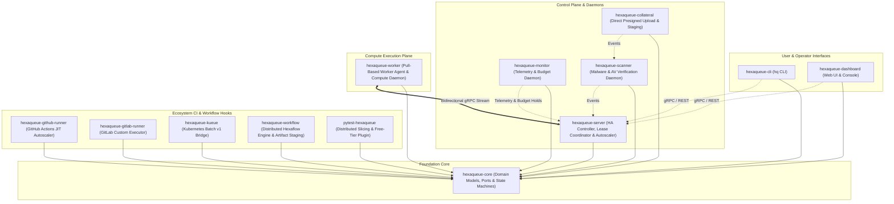

# ⚡ Hexaqueue

> **Cloud-Agnostic HPC Batch Scheduler and Distributed Job Orchestrator**

[](https://codespaces.new/TheTrueSCU/hexaqueue)
[](https://github.com/TheTrueSCU/hexaqueue/actions/workflows/ci.yml)
[](https://codecov.io/github/TheTrueSCU/hexaqueue)
[](https://pypi.org/project/hexaqueue/)
[](https://www.python.org/downloads/)
[](LICENSE)

[](https://dopplereffect.us/hexastack/)
[](https://dopplereffect.us/hexaflow/)
[](https://dopplereffect.us/hexaqual/)
[](https://dopplereffect.us/hexaqueue/)
[](https://github.com/astral-sh/ruff)
[](https://github.com/astral-sh/ty)
[](tests/e2e/test_dashboard_accessibility.py)

[](https://securityscorecards.dev/viewer/?uri=github.com/TheTrueSCU/hexaqueue)
[](https://www.bestpractices.dev/projects/14535)
[](https://www.bestpractices.dev/projects/14535)

> 🏛️ **Built 100% on [Hexastack](https://dopplereffect.us/hexastack/)** · 🌊 **Workflows powered by [Hexaflow](https://dopplereffect.us/hexaflow/)** · 🛡️ **Governed by [Hexaqual](https://dopplereffect.us/hexaqual/)**


---

## 🧭 Monorepo Package Architecture



---

## 📦 Hexastack Dependency Map

```mermaid
graph TD
    subgraph S1["Hexaqueue Packages"]
        HQ_CORE["hexaqueue-core"]
        HQ_CLI["hexaqueue-cli"]
        HQ_SERVER["hexaqueue-server"]
        HQ_WORKER["hexaqueue-worker"]
        HQ_COLLATERAL["hexaqueue-collateral"]
        HQ_SCANNER["hexaqueue-scanner"]
        HQ_MONITOR["hexaqueue-monitor"]
        HQ_DASHBOARD["hexaqueue-dashboard"]
        HQ_WORKFLOW["hexaqueue-workflow"]
    end

    subgraph S2["Hexastack Foundation"]
        HS_AUTH["hexastack-auth (SPIFFE/mTLS & OIDC)"]
        HS_CLI["hexastack-cli (Typer & Rich Output)"]
        HS_CORE["hexastack-core (DI Container & Ports)"]
        HS_CQRS["hexastack-cqrs (Commands, Queries, Events)"]
        HS_DB["hexastack-db (PostgreSQL / SQLite Persistence)"]
        HS_EVENTS["hexastack-events (NATS JetStream & Redis)"]
        HS_FASTAPI["hexastack-fastapi (REST & Middleware)"]
        HS_GRPC["hexastack-grpc (Protobuf Streaming & Reflection)"]
        HS_LOG["hexastack-logging (Structured JSON Logs)"]
        HS_MCP["hexastack-mcp (Model Context Protocol)"]
        HS_OTEL["hexastack-otel (OpenTelemetry & Prometheus)"]
        HS_UI["hexastack-ui (NiceGUI DevTools & Web UI)"]
    end

    HQ_CORE --> HS_CORE
    HQ_CORE --> HS_CQRS

    HQ_CLI --> HS_AUTH
    HQ_CLI --> HS_CLI
    HQ_CLI --> HS_CORE
    HQ_CLI --> HS_CQRS
    HQ_CLI --> HS_GRPC

    HQ_SERVER --> HS_AUTH
    HQ_SERVER --> HS_CORE
    HQ_SERVER --> HS_CQRS
    HQ_SERVER --> HS_DB
    HQ_SERVER --> HS_EVENTS
    HQ_SERVER --> HS_FASTAPI
    HQ_SERVER --> HS_GRPC
    HQ_SERVER --> HS_LOG
    HQ_SERVER --> HS_MCP
    HQ_SERVER --> HS_OTEL

    HQ_WORKER --> HS_AUTH
    HQ_WORKER --> HS_CORE
    HQ_WORKER --> HS_GRPC
    HQ_WORKER --> HS_LOG

    HQ_COLLATERAL --> HS_AUTH
    HQ_COLLATERAL --> HS_CORE
    HQ_COLLATERAL --> HS_EVENTS
    HQ_COLLATERAL --> HS_FASTAPI

    HQ_SCANNER --> HS_AUTH
    HQ_SCANNER --> HS_CORE
    HQ_SCANNER --> HS_EVENTS
    HQ_SCANNER --> HS_LOG

    HQ_MONITOR --> HS_CORE
    HQ_MONITOR --> HS_EVENTS
    HQ_MONITOR --> HS_OTEL

    HQ_DASHBOARD --> HS_AUTH
    HQ_DASHBOARD --> HS_CORE
    HQ_DASHBOARD --> HS_CQRS
    HQ_DASHBOARD --> HS_FASTAPI
    HQ_DASHBOARD --> HS_GRPC
    HQ_DASHBOARD --> HS_UI

    HQ_WORKFLOW --> HS_CORE
    HQ_WORKFLOW --> HS_GRPC
```



---

## ⚡ GitHub Action (`TheTrueSCU/hexaqueue`)

Use the repository's composite action (`action.yml`) in CI workflows to install `hq`, probe the fleet, and establish the zero-trust OpenSSH tunnel for `pytest-hexaqueue`:

```yaml
- uses: TheTrueSCU/hexaqueue@1e7b3c4625c82bece17dbc9eafc72664e4bd501c # v0.12.1
  with:
    cluster-env: ${{ secrets.HEXAQUEUE_ENV }}
    probe-only: "false"
    auto-tunnel: "true"
    step-summary: "true"
```

---

## 📚 Package Directory Index

| Package | Description |
|---|---|
| [`hexaqueue`](packages/hexaqueue/README.md) | Umbrella metapackage (`pip install hexaqueue`, optional `[oci]`, `[github]`, `[gcp]`, `[oracle]`, `[dotenv]`, `[pytest]`, `[sentry]`) |
| [`hexaqueue-core`](packages/hexaqueue_core/README.md) | Pure domain models, lifecycle state machines, port interfaces |
| [`hexaqueue-cli`](packages/hexaqueue_cli/README.md) | `hq` interactive terminal CLI |
| [`hexaqueue-server`](packages/hexaqueue_server/README.md) | HA controller, lease coordinator & scale-to-zero autoscaler engine |
| [`hexaqueue-worker`](packages/hexaqueue_worker/README.md) | Compute daemon & autonomous pull-based worker agent (cgroups v2, GPU isolation) |
| [`hexaqueue-collateral`](packages/hexaqueue_collateral/README.md) | Direct presigned multi-part upload & OCI Object Storage staging service |
| [`hexaqueue-scanner`](packages/hexaqueue_scanner/README.md) | Malware scanning, AV (ClamAV/YARA) & quarantine daemon |
| [`hexaqueue-monitor`](packages/hexaqueue_monitor/README.md) | Health, heartbeat telemetry & budget tracking daemon |
| [`hexaqueue-dashboard`](packages/hexaqueue_dashboard/README.md) | Web interface, cluster visualizer & operator console |
| [`hexaqueue-github-runner`](packages/hexaqueue_github_runner/README.md) | GitHub Actions JIT autoscaler & webhook bridge |
| [`hexaqueue-gitlab-runner`](packages/hexaqueue_gitlab_runner/README.md) | GitLab CI/CD Custom Executor driver |
| [`hexaqueue-kueue`](packages/hexaqueue_kueue/README.md) | Kubernetes Batch v1 & Kueue controller bridge |
| [`hexaqueue-workflow`](packages/hexaqueue_workflow/README.md) | Distributed Hexaflow cluster workflow engine & artifact staging adapter |
| [`pytest-hexaqueue`](packages/pytest_hexaqueue/README.md) | Distributed Pytest execution, test suite slicing engine, and multi-CSP free-tier runner plugin |
