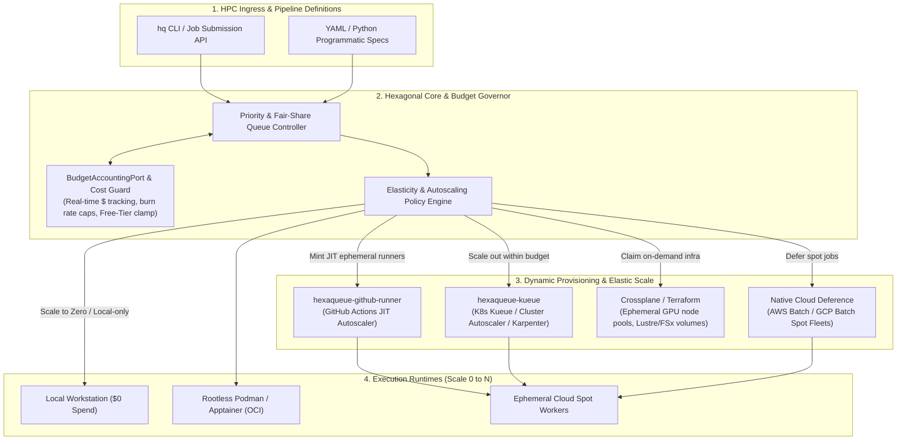
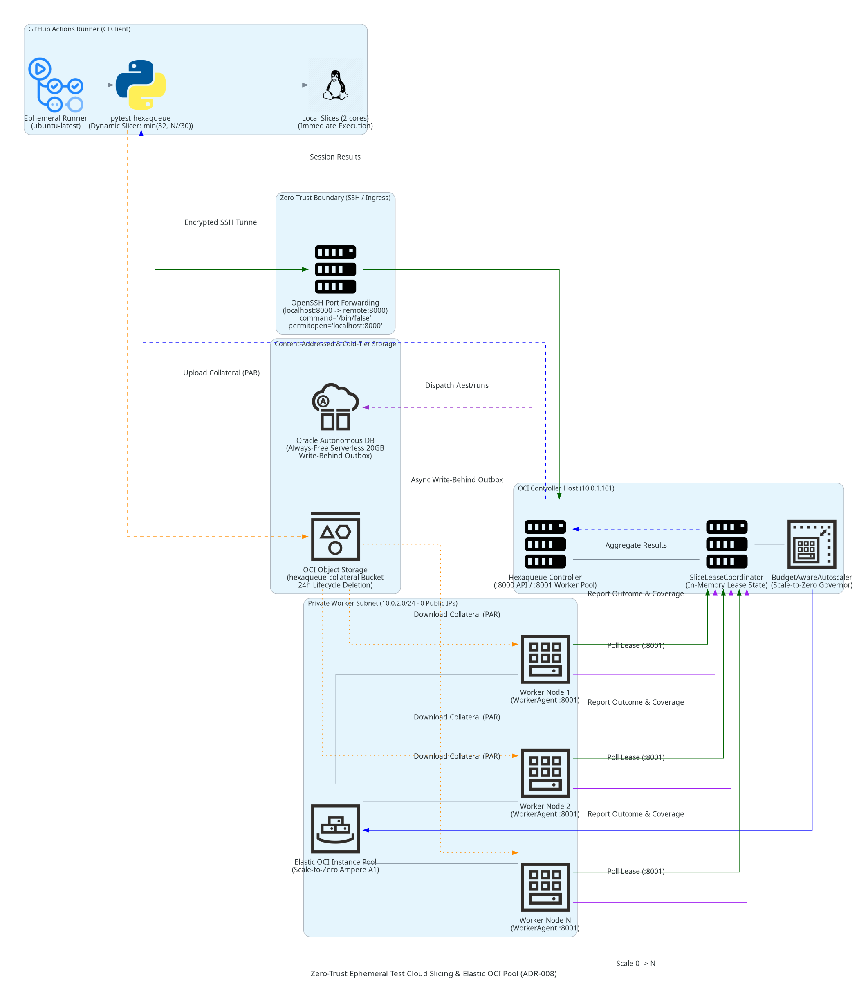

# Architecture & Ecosystem Integration

> Hexaqueue decouples core scheduling logic, graph dependency evaluation, storage isolation, and compute runtimes across strict hexagonal layers while modernizing traditional HPC batch systems (LSF, SGE, Univa) with cloud-native elasticity and dynamic budget governance.

---

## 1. The Hexagonal Golden Rules

1. **Pure Domain Center (`domain/`)**:
   - Zero framework or infrastructure dependencies.
   - Contains pure models (`JobSpec`, `RunSpec`, `ResourceRequirements`), DAG graph validation (`JobDagEngine`), parameter matrix compilers (`GroupExpansionEngine`), and lifecycle state machines (`compute_run_state`, `compute_run_outcome`).
   - All domain exceptions subclass `HexaqueueError`.

2. **Ports as Inversion Boundaries (`ports/`)**:
   - `JobQueuePort`: Abstract task enqueueing, dequeueing, and priority indexing.
   - `SchedulerControllerPort`: Central pipeline submission and status aggregation.
   - `StorageVolumePort`: Isolated scratch storage allocation and ephemeral cleanup.
   - `ExecutionRuntimePort`: Subprocess and containerized process execution.
   - `BudgetAccountingPort`: Real-time dollar-denominated budget tracking, burn rate caps, and spot instance arbitration.
   - `LogStreamPort`: Chunked stdout/stderr real-time streaming.

3. **Adapters Implement Ports (`adapters/`)**:
   - Translate external protocols (POSIX subprocesses, local memory queues, disk storage, S3/GCS, Kubernetes Kueue, Temporal/Argo) into internal domain contracts.
   - Adapters never import from `infra/`.

4. **Zero-Cost Guard & Native Deference**:
   - Provides software-managed local adapters and provider-native deference adapters (AWS Batch, GCP Batch).
   - Supports `FREE_TIER` resource clamping for $0 cloud spend developer loops.

---

## 2. Modernizing Traditional HPC (LSF, SGE, Univa) with Cloud Elasticity

Traditional HPC batch schedulers (IBM Spectrum LSF, Sun/Oracle Grid Engine SGE, Univa/Altair Grid Engine, and Slurm) were architected for static, on-premise clusters with fixed node counts and shared NFS mounts.

Hexaqueue retains drop-in user familiarity (declarative DAGs, job dependencies like `AFTER_OK`, resource requests, arrays) while solving legacy pain points through **scale-to-zero elasticity**, **dollar-denominated budget enforcement**, and **hermetic container isolation**:



### Key Elastic Capabilities:
* **Scale-from-Zero to N (and Scale-to-Zero)**:
  Instead of burning budget on idle compute nodes, `hexaqueue-kueue` interacts with Kubernetes cluster autoscalers, Karpenter, and cloud batch fleets. Worker nodes spin up on demand and terminate immediately when queues drain.
* **Dollar-Denominated Budget Guards (`BudgetAccountingPort`)**:
  Project tenants and individual pipeline runs can enforce strict dollar limits (e.g., `$50/run` or `$500/day`). When budgets tighten, the scheduler automatically shifts workloads to Spot/Preemptible instances or local runtimes.
* **Hermetic Collateral vs. Fragile NFS**:
  Replaces fragile global shared filesystems with content-addressable collateral (`hexaqueue-collateral`) and rootless container isolation (`hexaqueue-worker`).

---

## 3. Infrastructure & Packaging Ecosystem

Hexaqueue clearly separates container packaging, static infrastructure bootstrap, and dynamic cloud claims across three key tools:

| Ecosystem Tool | Hexaqueue Layer | Primary Responsibility |
|---|---|---|
| **Docker / Dockerfile** | `hexaqueue-worker` | Packaging reproducible OCI container images (Apptainer / Podman / Docker) with hermetic read-only collateral volume mounts. |
| **Terraform / OpenTofu** | Infrastructure Bootstrap | Declarative, static provisioning of baseline VPCs, Kubernetes clusters (EKS/GKE/AKS), cloud object stores (S3/GCS), and IAM roles. |
| **Crossplane** | `hexaqueue-kueue` & Cloud Claims | Kubernetes-native control plane managing dynamic, on-demand infrastructure claims (e.g., ephemeral Lustre/FSx storage volumes or dedicated GPU node pools). |

---

## 4. Zero-Trust Ephemeral Test Cloud Slicing & Elastic OCI Pool (ADR-008)

Hexaqueue includes native, zero-trust cloud test acceleration via `pytest-hexaqueue` and `hq cluster tunnel`. Instead of running multi-thousand test suites sequentially on developer laptops or slow CI runners, tests are dynamically sliced, content-addressed into CAS archives, and distributed across elastic, scale-to-zero cloud compute pools over an encrypted, port-restricted OpenSSH tunnel.



### Architectural Invariants & Security Boundaries

1. **Zero-Trust OpenSSH Confinement (`hexaqueue-ci`)**:
   - Remote access operates through a dedicated, unprivileged system account (`hexaqueue-ci`) configured with a `/bin/false` shell, no sudo privileges, and zero write access to system services or repository checkouts.
   - Remote authentication is strictly confined via OpenSSH `authorized_keys` forced directives:
     ```ssh-config
     command="/bin/false",no-pty,no-agent-forwarding,no-X11-forwarding,permitopen="localhost:8000",permitopen="127.0.0.1:8000" <ci_public_key>
     ```
   - CI runners establish a restricted local port forward (`-L 8000:localhost:8000 -N`). Shell execution and arbitrary remote commands are rejected with exit code 1.

2. **Elastic Scale-to-Zero Compute Pool & Pull-Based Leasing (ADR-008)**:
   - When test slices are submitted, the controller's `BudgetAwareInstancePoolAutoscaler` dynamically scales up worker nodes in an isolated cloud instance pool (OCI Ampere A1 ARM64) inside a private subnet (`10.0.2.0/24`) with 0 public IPs.
   - Autonomous worker daemons (`WorkerAgent`) register on boot, poll leases from `SliceLeaseCoordinator` over port 8001, and stream heartbeats.
   - Once all slices are executed, the queue drains and the autoscaler scales the instance pool back to 0 instances.

3. **Content-Addressed Storage (CAS) & Pre-Authenticated Requests (PAR)**:
   - Client workspaces snapshot uncommitted diffs and repository files into a deterministic `.tar.gz` archive and stage them directly via OCI Object Storage bucket (`hexaqueue-collateral`).
   - Workers download collateral directly from Object Storage using secure, short-lived Pre-Authenticated Request (PAR) URLs with automated 24-hour lifecycle bucket expiration.

4. **Hermetic Virtualenv Isolation & Clean Reporting**:
   - Each distributed test slice executes inside an isolated workspace virtualenv (`workspace_dir/.venv/bin/python -m pytest`).
   - Results (JUnit XML and coverage artifacts) stream back in real time and are seamlessly merged on the client.

### Hybrid Slicing Partitioning: Local vs. Remote Concurrency

`pytest-hexaqueue` provides fine-grained control over local workstation vs. remote cloud compute allocation through `--hq-local-slices` and `--hq-remote-slices`:

| Execution Mode | `--hq-local-slices` | `--hq-remote-slices` | `--hq-slices` | Total Slices | Local Slices ($L$) | Remote Slices ($R$) | Description / Resource Allocation |
|---|---|---|---|---|---|---|---|
| **Default Remote** | `None` (0) | `None` (Config) | $N$ (default `4`) | $N$ | `0` | $N$ | Standard cluster execution. 100% of slices dispatch to remote workers; local machine remains idle. |
| **Pure Remote (Zero Local Load)** | `0` | `auto` or $R$ | Any | $R$ | `0` | $R$ | Explicitly forces 0 local slices. Offloads 100% of execution to cloud fleet; ideal for low-resource CI runners. |
| **Pure Local (Offline / No Cloud)** | `auto` or $L$ | `0` | Any | $L$ | $L$ | `0` | Bypasses remote cluster completely. Runs $L$ slices locally across workstation cores using subprocesses. |
| **Explicit Hybrid Split** | $L$ (e.g. `2`) | $R$ (e.g. `16`) | Ignored | $L + R$ (18) | $L$ (2) | $R$ (16) | Exact allocation. Slices $1..L$ run locally; slices $L+1..L+R$ dispatch to the remote cluster in parallel. |
| **Hybrid Auto-Scale (`--hq-hybrid`)** | `auto` (implied) | `auto` (implied) | $N$ (or default) | $\max(N, L + R)$ | $\max(1, \text{cores} - 2)$ | $\max(4, \min(32, \frac{\text{tests}}{30}))$ | Dynamic queue saturation. Uses local cores minus 2 for local slices, and dynamically over-partitions remote slices to saturate cluster queues. |
| **Local Target with Auto Remote** | $L$ (e.g. `2`) | `None` | $N$ (e.g. `10`) | $\max(L, N)$ (10) | $L$ (2) | $N - L$ (8) | Dedicates $L$ slices locally, allocating the remaining $N - L$ slices to remote cloud workers. |
| **Remote Target with Auto Local** | `None` | $R$ (e.g. `8`) | $N$ (e.g. `10`) | $\max(R, N)$ (10) | $N - R$ (2) | $R$ (8) | Caps remote execution at $R$ slices, allocating remaining $N - R$ slices to the local machine. |
