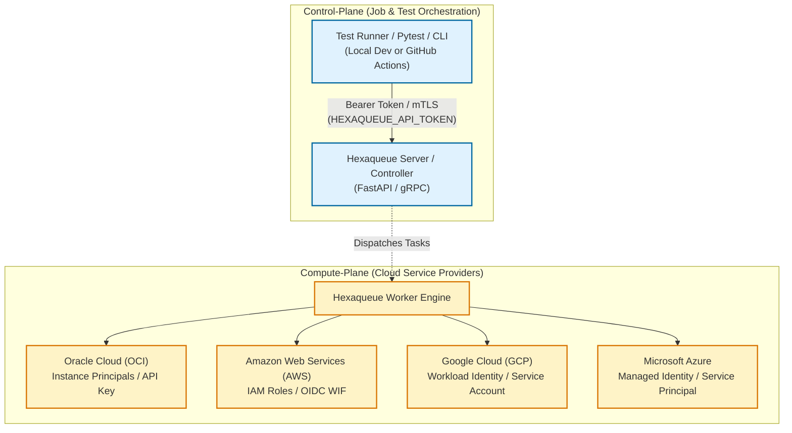
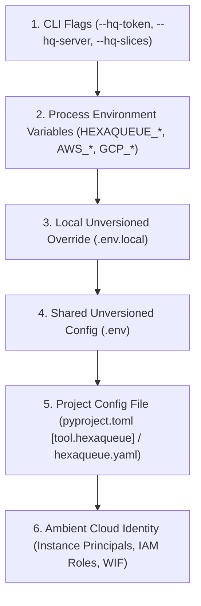

# Hexaqueue Authentication & Secrets Governance

This guide provides an authoritative reference for securely configuring credentials, tokens, and cloud identity across Hexaqueue cluster components, client tools, and continuous integration workflows.

---

## 1. Architectural Principles: Plane Separation

Hexaqueue enforces a strict architectural boundary between **Control-Plane Authentication** and **Compute-Plane Cloud Authorization**:



### Key Invariant
> **The Test Runner Invariant**: Test execution clients (`pytest-hexaqueue`, `hexaqueue job submit`, CI matrix runners) **never require and must never possess CSP cloud credentials**. They only communicate with the Hexaqueue control plane via an API token. Cloud credentials remain strictly quarantined within the controller/worker infrastructure.

---

## 2. The Four Execution Topologies

Hexaqueue is designed to operate securely across four distinct operational contexts:

| Operational Context | Client Auth | Controller Auth | Secrets Location |
|---|---|---|---|
| **1. Local Hexaqueue** | Localhost / None or Dev Token | Ambient CLI Profile or `.env.local` | Developer workstation (ignored in git) |
| **2. Hexaqueue in GitHub Actions** | GitHub Job Context | OIDC Workload Identity (WIF) | GitHub Secrets / Cloud IAM |
| **3. Local Pytest (`pytest-hexaqueue`)** | `HEXAQUEUE_API_TOKEN` | Remote Controller handles CSPs | `.env.local` or environment variable |
| **4. Pytest in GitHub Actions** | `HEXAQUEUE_API_TOKEN` | Remote Controller or Local Fallback | GitHub Actions Repository Secret |

---

### Context 1: Local Hexaqueue Controller & Worker

Developers running `hexaqueue-server` locally can authenticate against cloud providers using either:
1. **Unversioned `.env.local` files**:
   Create `.env.local` in the project root based on `.env.example`. It is automatically discovered walking upward to the repository root and is strictly git-ignored.
2. **Ambient Cloud CLI Profiles**:
   Hexaqueue automatically falls back to standard developer logins:
   - AWS: `~/.aws/credentials` configured via `aws configure`
   - OCI: `~/.oci/config`
   - GCP: `gcloud auth application-default login`

---

### Context 2: Hexaqueue Controller in GitHub Actions

When running the controller or worker nodes directly in GitHub Actions workflows, prefer **Keyless OIDC Workload Identity Federation (WIF)** over long-lived access keys:

```yaml
# .github/workflows/hexaqueue-controller.yml
name: Hexaqueue Controller
on: [push]

permissions:
  id-token: write  # Required for OIDC WIF
  contents: read

jobs:
  start-controller:
    runs-on: ubuntu-latest
    steps:
      - uses: actions/checkout@v4

      # AWS Keyless OIDC Role Assumption
      - name: Configure AWS Credentials (OIDC)
        uses: aws-actions/configure-aws-credentials@v4
        with:
          role-to-assume: arn:aws:iam::123456789012:role/hexaqueue-ci-runner
          aws-region: us-east-1

      # GCP Keyless Workload Identity Federation
      - name: Authenticate to Google Cloud (WIF)
        uses: google-github-actions/auth@v2
        with:
          workload_identity_provider: 'projects/123/locations/global/workloadIdentityPools/github/providers/hexaqueue'
          service_account: 'hexaqueue-runner@project.iam.gserviceaccount.com'

      - name: Launch Controller
        run: |
          uv run hexaqueue-server start --port 8000
```

---

### Context 3: Local Pytest (`pytest-hexaqueue`)

Developers invoking distributed tests simply point to an active controller. No CSP keys are needed on the developer's laptop:

```bash
# 1. Set environment variable or place in .env.local
export HEXAQUEUE_SERVER_URL="https://hexaqueue.internal.corp"
export HEXAQUEUE_API_TOKEN="hq_live_abcdef123456"

# 2. Run pytest with distributed execution
pytest --hexaqueue --hq-slices 8
```

If the controller is temporarily unreachable, `pytest-hexaqueue` automatically falls back to in-process local execution, ensuring zero developer friction:

```bash
# Explicit fallback flag (defaults to True)
pytest --hexaqueue --hq-fallback
```

---

### Context 4: Pytest in GitHub Actions with or without Hexaqueue

In GitHub Actions, test jobs can offload execution to a cluster while maintaining seamless fallback if the cluster is unavailable:

```yaml
# .github/workflows/test.yml
name: Distributed Test Suite
on: [push, pull_request]

jobs:
  test:
    runs-on: ubuntu-latest
    steps:
      - uses: actions/checkout@v4
      - uses: astral-sh/setup-uv@v5

      - name: Run Pytest with Hexaqueue Offloading
        env:
          HEXAQUEUE_SERVER_URL: ${{ vars.HEXAQUEUE_SERVER_URL || 'http://127.0.0.1:8000' }}
          HEXAQUEUE_API_TOKEN: ${{ secrets.HEXAQUEUE_API_TOKEN }}
        run: |
          uv run pytest --hexaqueue --hq-profile ci
```

---

## 3. Multi-Tier Resolution Hierarchy

Credentials and settings are resolved hierarchically from most specific to least specific:



### Precedence Rules:
1. **Explicit CLI flags** override all environment and configuration settings.
2. **Process environment variables** (including GitHub Actions Secrets) override config files and `.env` files.
3. **`.env.local`** overrides keys defined in `.env`.
4. **`.env`** provides default local environment configurations.
5. **Project Config File** (`pyproject.toml [tool.hexaqueue]` or `hexaqueue.yaml`) provides version-controlled topology defaults and named profiles.
6. If no explicit keys are provided, cloud provider SDKs automatically check for **ambient identity** (Instance Principals on OCI, IAM instance profiles on AWS EC2, Managed Identity on Azure, Workload Identity on GCP).

---

## 4. Secret Protection & Invariant Defense

To eliminate accidental secret exposure in git, logs, or CI artifacts:

1. **Pydantic `SecretStr` Encapsulation**:
   All sensitive fields (`key_content`, `access_key_id`, `client_secret`, `service_account_json`) are strictly encapsulated in `SecretStr`. Calling `repr()`, `str()`, or `model_dump()` will output `**********`, never revealing the raw secret.
2. **Log Scrubbing (`LogSanitizer`)**:
   Hexastack's structured logging engine scrubs cloud credentials, PEM private keys, AWS access keys, and authorization bearer tokens using high-entropy pattern detection before writing logs or traces to disk.
3. **Pre-commit Quality Gates**:
   Git hooks enforce `detect-secrets` and `detect-private-key` on every commit, preventing developers from committing unversioned tokens or private key files.
