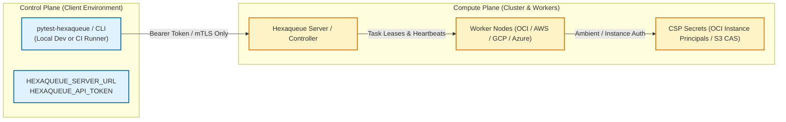
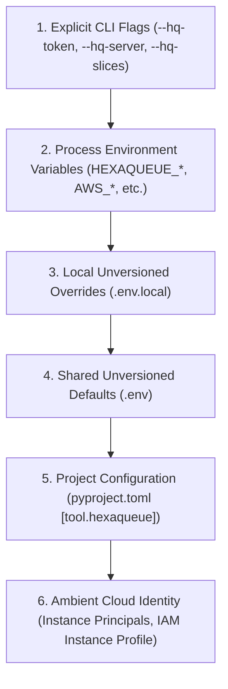

# Hexaqueue Environment & Configuration Reference

This guide provides an exhaustive specification of configuration discovery, precedence hierarchy, plane secret isolation, and all environment variables supported by the Hexaqueue cluster engine and client tooling.

---

## 1. Plane Separation & Secrets Isolation

Hexaqueue enforces a strict architectural boundary between **Control-Plane** test clients and **Compute-Plane** worker nodes:



> [!IMPORTANT]
> **The Test Runner Invariant**: Client runners executing test suites or mutation testing (`pytest-hexaqueue`, `hexaqual mutate --cluster hexaqueue`, `hq run submit`) **never require and must never possess CSP cloud credentials** (such as OCI tenancy/user OCIDs, private keys, or AWS secret access keys).
>
> Clients connect exclusively to the Hexaqueue control plane via `HEXAQUEUE_SERVER_URL` and `HEXAQUEUE_API_TOKEN`. All cloud infrastructure management is quarantined inside the controller and worker nodes.

---

## 2. Configuration Precedence Hierarchy

Settings are resolved hierarchically from most specific to least specific:



### Precedence Rules:
1. **Explicit CLI Flags**: Command-line options (e.g. `--hq-token`, `--hq-server`, `--hq-slices`) take highest precedence and override all configuration files and environment variables.
2. **Process Environment Variables**: Shell environment variables and CI workflow secrets (e.g. `HEXAQUEUE_API_TOKEN`) override `.env` and `.env.local` files.
3. **`.env.local`**: Unversioned local developer overrides. Hexaqueue automatically discovers `.env.local` by traversing parent directories up to the Git repository root.
4. **`.env`**: Default unversioned configuration file. Discovered alongside `.env.local`.
5. **Project Configuration (`pyproject.toml`)**: Version-controlled defaults under `[tool.hexaqueue]` or `[tool.pytest.ini_options]`.
6. **Ambient Cloud Identity**: If no explicit cloud keys are configured on worker nodes, provider SDKs check for instance-level identity (OCI Instance Principals, AWS IAM Roles for EC2/ECS, GCP Workload Identity, Azure Managed Identity).

---

## 3. Comprehensive Configuration Reference

Hexaqueue ships with a template file [`.env.example`](file:///.env.example). Below is the complete reference of all recognized variables.

### 3.1 Control-Plane Variables (Clients & Test Runners)

| Variable Name | Default Value | Description |
|---|---|---|
| `HEXAQUEUE_SERVER_URL` | `http://127.0.0.1:8000` | Hexaqueue controller HTTP/REST API base URL. |
| `HEXAQUEUE_API_TOKEN` | *(None)* | Bearer authentication token used by clients to authenticate with the server. |
| `HEXAQUEUE_SLICES` | `4` | Default number of parallel task slices to generate when distributing test runs. |
| `HEXAQUEUE_POOL` | `default` | Target worker instance pool or queue name for submitted jobs. |
| `HEXAQUEUE_FREE_TIER` | `true` | Restrict cluster worker allocation and scaling strictly within free-tier resource bounds. |
| `HEXAQUEUE_FALLBACK` | `true` | When `true`, automatically fall back to local test execution if the remote cluster is unreachable. |
| `HEXAQUEUE_TIMEOUT` | `1800` | Maximum timeout in seconds before timing out remote execution. |

---

### 3.2 Compute-Plane: Oracle Cloud Infrastructure (OCI)

Used on controller and worker daemons managing OCI Ampere A1 Free-Tier pools:

| Variable Name | Format / Example | Description |
|---|---|---|
| `HEXAQUEUE_CSP_PROVIDER` | `OCI` | Cloud service provider adapter to activate (`OCI`, `AWS`, `GCP`, `AZURE`, `LOCAL`). |
| `HEXAQUEUE_OCI_INSTANCE_PRINCIPALS` | `true` / `false` | Enable ambient VM-level authentication via OCI Dynamic Groups and Instance Principals. When enabled, API keys are not required. |
| `HEXAQUEUE_OCI_TENANCY_OCID` | `ocid1.tenancy.oc1..[redacted]` | OCI tenancy identifier for API-key based authentication. |
| `HEXAQUEUE_OCI_USER_OCID` | `ocid1.user.oc1..[redacted]` | OCI IAM user identifier. |
| `HEXAQUEUE_OCI_FINGERPRINT` | `aa:bb:cc:dd:...` | Fingerprint of the public key registered in the OCI IAM Console. |
| `HEXAQUEUE_OCI_KEY_FILE` | `/home/ubuntu/.oci/oci_api_key.pem` | Local filesystem path to the private PEM key. |
| `HEXAQUEUE_OCI_KEY_CONTENT` | *(Redacted PEM string)* | Inline PEM content of the private key (useful for CI/CD secret injection). |
| `HEXAQUEUE_OCI_REGION` | `us-phoenix-1` | OCI geographic region identifier. |
| `HEXAQUEUE_OCI_INSTANCE_POOL_ID` | `ocid1.instancepool.oc1.phx..[redacted]` | OCI Instance Pool OCID used for elastic autoscaling of worker nodes. |
| `HEXAQUEUE_COLLATERAL_BUCKET` | `hexaqueue-collateral` | OCI Object Storage bucket name for Content-Addressable Storage (CAS) test bundles. |

---

### 3.3 Compute-Plane: Amazon Web Services (AWS)

Used when running the controller or worker daemons on AWS EC2 or utilizing S3 CAS:

| Variable Name | Default Value | Description |
|---|---|---|
| `HEXAQUEUE_AWS_USE_IAM_ROLE` | `false` | Enable ambient AWS IAM instance profile or container role authentication. |
| `HEXAQUEUE_AWS_REGION` | `us-east-1` | Target AWS region. |
| `HEXAQUEUE_AWS_ACCESS_KEY_ID` | *(None)* | AWS Access Key ID (standard `AWS_ACCESS_KEY_ID` also supported). |
| `HEXAQUEUE_AWS_SECRET_ACCESS_KEY` | *(None)* | AWS Secret Access Key (standard `AWS_SECRET_ACCESS_KEY` also supported). |
| `HEXAQUEUE_AWS_SESSION_TOKEN` | *(None)* | Temporary session token for STS-assumed roles. |
| `HEXAQUEUE_AWS_PROFILE` | `default` | Named AWS CLI credentials profile in `~/.aws/credentials`. |

---

### 3.4 Compute-Plane: Google Cloud Platform (GCP) & Azure

| Variable Name | Default Value | Description |
|---|---|---|
| `HEXAQUEUE_GCP_PROJECT_ID` | *(None)* | Google Cloud project identifier. |
| `HEXAQUEUE_GCP_ZONE` | `us-central1-a` | Compute Engine compute zone. |
| `HEXAQUEUE_GCP_USE_WORKLOAD_IDENTITY`| `false` | Authenticate using ambient GCE Service Account or GitHub OIDC Workload Identity Federation. |
| `HEXAQUEUE_GCP_SERVICE_ACCOUNT_FILE` | *(None)* | Path to service account JSON key file (standard `GOOGLE_APPLICATION_CREDENTIALS` supported). |
| `HEXAQUEUE_AZURE_TENANT_ID` | *(None)* | Microsoft Entra (Azure AD) Directory Tenant ID. |
| `HEXAQUEUE_AZURE_CLIENT_ID` | *(None)* | Application (Client) ID of the Service Principal. |
| `HEXAQUEUE_AZURE_CLIENT_SECRET` | *(None)* | Client Secret value. |
| `HEXAQUEUE_AZURE_USE_MANAGED_IDENTITY`| `false` | Enable Azure VM System-Assigned or User-Assigned Managed Identity. |

---

### 3.5 Worker Daemon & Cluster Networking

| Variable Name | Default Value | Description |
|---|---|---|
| `HEXAQUEUE_WORKER_PORT` | `8001` | Local port used by `hexaqueue-worker` for internal task execution. |
| `HEXAQUEUE_SSH_USER` | `ubuntu` | SSH user account used by bastion jump scripts to access worker instances. |
| `HEXAQUEUE_SSH_KEY` | `~/.ssh/id_ed25519` | Private SSH key path for cluster node management. |
| `HEXAQUEUE_CLUSTER_HOST` | *(None)* | Public IP address or DNS hostname of the primary bastion / controller node. |

---

## 4. Setting Up Local Development

To configure your local environment for development:

1. Copy the example template into an unversioned `.env.local` file:
   ```bash
   cp .env.example .env.local
   ```
2. Edit `.env.local` to point to your local or remote controller:
   ```ini
   HEXAQUEUE_SERVER_URL=http://127.0.0.1:8000
   HEXAQUEUE_API_TOKEN=dev-secret-token
   ```
3. Verify discovery using the `hq` CLI:
   ```bash
   uv run hq status
   ```

> [!NOTE]
> `.env.local` and `.env` are protected by `.gitignore` and Hexaqual security quality gates. Never check production tokens, private keys, or actual cloud identifiers into version control.
