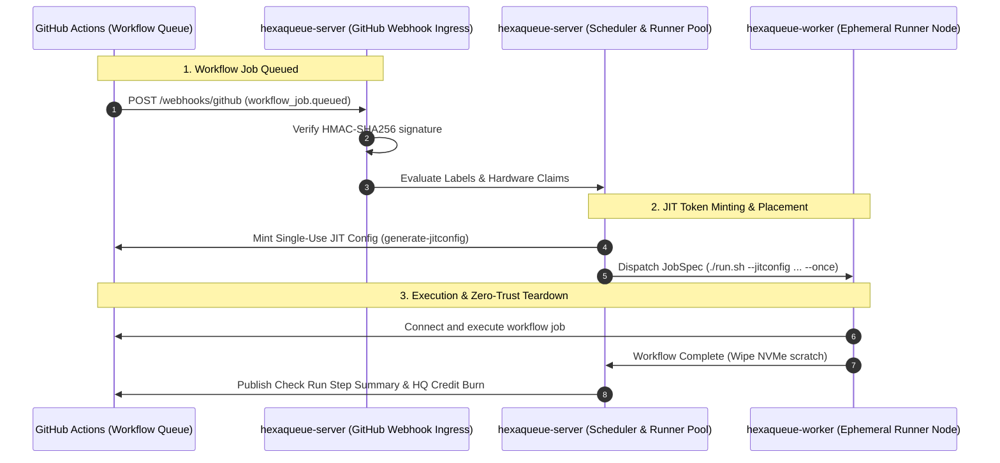

# GitHub Actions Dynamic Runner Autoscaler Guide

> High-performance, cost-effective self-hosted GitHub Actions runner autoscaler with zero-trust single-job isolation and dynamic hardware claims.

---

## 🎯 Overview

Hexaqueue provides a first-class, cloud-agnostic integration bridge for GitHub Actions via the [`hexaqueue-github-runner`](../packages/hexaqueue_github_runner/README.md) package. It allows Hexaqueue clusters to serve as an intelligent runner autoscaler, translating inbound webhook events into isolated execution tasks with micro-latency queueing and fine-grained credit accounting.



---

## 🔑 GitHub App Setup & Permissions

To authenticate and manage Just-In-Time (JIT) ephemeral runners, register a GitHub App in your organization or user account:

1. **Repository / Organization Permissions**:
   - `Actions`: **Read & write** (for generating JIT runner registration configurations)
   - `Administration`: **Read & write** (for registering and deregistering runners)
   - `Checks`: **Read & write** (for publishing execution performance annotations)
   - `Metadata`: **Read-only**

2. **Subscribe to Webhook Events**:
   - `Workflow job` (emits `queued`, `in_progress`, and `completed` events)

3. **Webhook URL & Secret**:
   - URL: `https://<your-hexaqueue-server>/webhooks/github`
   - Content type: `application/json`
   - Secret: Configure a cryptographically secure token and supply it to Hexaqueue via `HEXAQUEUE_WEBHOOK_SECRET_GITHUB`.

---

## 🏷️ Label-to-Hardware Translation

Hexaqueue eliminates manual runner fleet management by automatically mapping GitHub Actions `runs-on` labels to pure domain [`ResourceRequirements`](../packages/hexaqueue_core/README.md):

| Label Syntax | Parsed Claim | Example Label |
|---|---|---|
| `(\d+)-cores?`, `cpu-(\d+)` | CPU Core Count | `16-cores`, `cpu-8`, `4-cpu` |
| `(\d+)gb(?:-ram)?`, `ram-(\d+)gb` | Memory (RAM) | `64gb`, `ram-32gb` |
| `gpu-(\w+)`, or GPU model keyword | Dedicated GPU Accelerator | `gpu-h100`, `a100`, `l4`, `t4`, `rtx4090` |
| `(\d+)-gpu-(\w+)` | Multi-GPU Accelerator Pool | `4-gpu-a100`, `2x-gpu-h100` |
| `(\d+)gb-scratch`, `scratch-(\d+)gb` | Local NVMe Scratch Space | `100gb-scratch`, `scratch-50gb` |
| `(\d+)h-walltime`, `(\d+)m-walltime` | Execution Time Limit (SIGKILL) | `2h-walltime`, `90m-walltime` |

### Example GitHub Actions Workflow

```yaml
name: Distributed GPU Training
on: [push]

jobs:
  train:
    runs-on: [self-hosted, linux, 16-cores, 64gb, gpu-h100, 100gb-scratch, 2h-walltime]
    steps:
      - uses: actions/checkout@v4
      - name: Run PyTorch Benchmark
        run: python train.py --epochs 10
```

---

## 🛡️ Single-Job Isolation & Ephemeral Teardown

1. **Zero Cross-Job Contamination**:
   - Runners are spawned with `--once` and bound strictly to the JIT configuration blob.
   - Once the job finishes, the runner daemon exits immediately.
2. **Scratch Disk Sanitization**:
   - Local NVMe scratch volumes mounted at `_work` are wiped immediately following process termination.
   - Memory and GPU VRAM are cleared before the node is returned to the allocatable cluster pool.

---

## ⚡ Pre-Warmed Pools for Micro-Latency

For high-frequency test suites (such as pull request smoke tests), latency can be eliminated using pre-warmed static pools:

```python
from hexaqueue.github_runner import (
    DynamicGitHubRunnerAutoscaler,
    WarmPoolConfig,
)

# Maintain 3 warm idle runners ready to pick up jobs instantaneously
autoscaler.register_warm_pool(
    WarmPoolConfig(
        pool_id="fast-ci",
        labels=["self-hosted", "fast-ci"],
        min_idle=3,
        max_capacity=10,
    )
)
```

---

## 📊 Two-Way Observability & Step Summaries

Upon workflow completion, Hexaqueue posts an execution summary to the GitHub Check Run:

```markdown
### ⚡ Hexaqueue Runner Execution Report

| Metric | Value |
|---|---|
| **Hexaqueue Job ID** | `job-gh-99881` |
| **Hexaqueue Run ID** | `run-gh-my-repo-4412` |
| **Status** | `COMPLETED` |
| **Duration** | `42.50s` |
| **Credits Consumed** | `0.0295 HQ` |

**Resource Allocation Details:**
- **Cluster Node**: `node-gpu-h100-03`
- **GPU Model**: `h100`
- **Single-Job Isolation**: Verified (Scratch wiped upon exit)
```
