# OCI Always-Free Tier Production Runbook

This guide provides a comprehensive, production-grade runbook for provisioning, hardening, and deploying Hexaqueue onto Oracle Cloud Infrastructure (OCI) Always-Free Tier infrastructure (Ampere A1 ARM64 compute, Object Storage CAS, and systemd automation).

---

## 1. Architecture & Free-Tier Capacity Plan

Oracle Cloud Infrastructure provides a generous Always-Free Tier suitable for running high-throughput distributed test and mutation crunching:
- **Compute**: 4 OCPUs and 24 GB RAM across Ampere A1 ARM64 architecture (`VM.Standard.A1.Flex`).
- **Storage**: 200 GB total Block Volume capacity (shared across boot and block volumes) and 10 GB Always-Free Object Storage.
- **Database**: 2 Always-Free Oracle Autonomous Databases (ADB Serverless, 20 GB storage each) for durable cold-tier run history, job specifications, and telemetry persistence via an asynchronous write-behind outbox.
- **Networking**: 1 VCN with public and private subnets, internet gateway, and NAT gateway.

```mermaid
flowchart TD
    subgraph VCN["Virtual Cloud Network (10.0.0.0/16)"]
        subgraph PublicSubnet["Public Subnet (10.0.1.0/24)"]
            BastionController["Primary Controller & Bastion<br/>(1 OCPU / 6 GB RAM)<br/>Public IP: 129.x.x.x<br/>hexaqueue.service:8000"]
        end

        subgraph PrivateSubnet["Private Subnet (10.0.2.0/24)"]
            Worker1["Worker 1 (1 OCPU / 6 GB)"]
            Worker2["Worker 2 (1 OCPU / 6 GB)"]
            Worker3["Worker 3 (1 OCPU / 6 GB)"]
            WorkerN["Worker ... (Dynamic Pool)"]
        end

        NAT["NAT Gateway"] --> PrivateSubnet
        BastionController -->|Leases / Task SSH| PrivateSubnet
    end

    Devs["Developers / CI Runners"] -->|HTTPS / SSH Tunnel| BastionController
    BastionController -->|Async Write-Behind Outbox| ADB["Oracle Autonomous Database<br/>(Always-Free ADB 20 GB)"]
    WorkerPool["Worker Nodes"] -->|Pull Collateral Tarballs| CAS["OCI Object Storage (CAS Bucket)"]

    classDef pub fill:#e0f2fe,stroke:#0369a1,stroke-width:2px;
    classDef priv fill:#fef3c7,stroke:#d97706,stroke-width:2px;
    classDef ext fill:#f3f4f6,stroke:#4b5563,stroke-width:2px;
    class BastionController pub;
    class Worker1,Worker2,Worker3,WorkerN priv;
    class Devs,CAS,ADB ext;
```



---

## 2. Infrastructure Provisioning

### Step 2.1: Virtual Cloud Network (VCN)
Create a VCN with the standard OCI wizard ("Create VCN with Internet Connectivity"):
- **VCN CIDR**: `10.0.0.0/16`
- **Public Subnet**: `10.0.1.0/24` (Hosts the Controller / Bastion VM)
- **Private Subnet**: `10.0.2.0/24` (Hosts Worker Instance Pool VMs)

#### Security List Rules:
1. **Public Subnet Ingress**:
   - TCP Port 22 (SSH): Restricted to your IP or CI bastion (zero-trust `hexaqueue-ci` tunnel forwarding `127.0.0.1:8000`, per ADR-007).
   - Port `8000` (Controller REST API): Bind strictly to `127.0.0.1:8000` (`--host 127.0.0.1 --port 8000`) and access exclusively via SSH tunnel (`-L 8000:localhost:8000`) rather than exposing publicly.
2. **Private Subnet Ingress**:
   - TCP Port 8001 (Internal Worker API): Allow from Worker Subnet / Private VCN (`worker-nsg`) via private VNIC IP only.
3. **Egress**:
   - Allow all outbound traffic via Internet Gateway (Public Subnet) and NAT Gateway (Private Subnet).

---

### Step 2.2: OCI Object Storage CAS Bucket
1. Open the OCI Console -> **Storage** -> **Buckets**.
2. Create a bucket named `hexaqueue-collateral` (or custom name).
3. Set default storage tier to **Standard**.
4. Configure bucket access policies to allow your worker VMs or Instance Principals read and write permissions to stage and retrieve test bundles.

---

### Step 2.3: Controller VM Provisioning
1. Launch an Ampere A1 Compute Instance (`VM.Standard.A1.Flex`):
   - **Shape**: 1 OCPU, 6 GB RAM.
   - **OS**: Ubuntu 24.04 LTS (aarch64) or Oracle Linux 9.
   - **Subnet**: Public Subnet.
   - **SSH Keys**: Add your administrator SSH public key.
2. Assign a Reserved Public IP to the instance to ensure a stable DNS/IP target.

---

## 3. Server Deployment & Systemd Configuration

Connect to the controller VM as the default user (`ubuntu`):

```bash
ssh ubuntu@<RESERVED_CONTROLLER_IP>
```

### Step 3.1: Install Prerequisites
```bash
sudo apt update && sudo apt install -y git curl build-essential python3-dev
curl -LsSf https://astral.sh/uv/install.sh | sh
source ~/.cargo/env
```

### Step 3.2: Clone Repository & Sync Dependencies
```bash
git clone https://github.com/TheTrueSCU/hexaqueue.git ~/hexaqueue
cd ~/hexaqueue
uv sync --all-packages --all-extras
```

### Step 3.3: Configure Production Systemd Unit (`hexaqueue.service`)

Create the systemd service file at `/etc/systemd/system/hexaqueue.service`:

```ini
[Unit]
Description=Hexaqueue Cluster Controller Daemon
After=network-online.target
Wants=network-online.target

[Service]
Type=simple
User=ubuntu
WorkingDirectory=/home/ubuntu/hexaqueue
Environment="HEXAQUEUE_CSP_PROVIDER=OCI"
Environment="HEXAQUEUE_WORKER_PORT=8001"
Environment="HEXAQUEUE_OCI_INSTANCE_POOL_ID=ocid1.instancepool.oc1.<region>.<example_instance_pool_ocid>"
Environment="HEXAQUEUE_COLLATERAL_BUCKET=hexaqueue-collateral"

# Optional: Auto-sync on startup
ExecStartPre=-/bin/bash -c "timeout 30s git fetch origin main && git reset --hard origin/main && git clean -fd && /home/ubuntu/.local/bin/uv sync --all-packages --all-extras"

ExecStart=/home/ubuntu/.local/bin/uv run hq server start --host 127.0.0.1 --port 8000
Restart=always
RestartSec=5

[Install]
WantedBy=multi-user.target
```

Enable and start the service:
```bash
sudo systemctl daemon-reload
sudo systemctl enable --now hexaqueue.service
```

Verify service status:
```bash
sudo systemctl status hexaqueue.service
sudo journalctl -u hexaqueue.service -f
```

### Step 3.4: Standalone Operator Dashboard & Dual Remote Access (SSH Tunnel + Tailscale Serve)

Deploy the standalone NiceGUI/FastAPI operator console from [`deploy/systemd/hexaqueue-dashboard.service`](../../deploy/systemd/hexaqueue-dashboard.service) bound strictly to loopback (`127.0.0.1:8080`) with trusted loopback proxy headers enabled (`--proxy-headers --forwarded-allow-ips=127.0.0.1`):

```bash
sudo cp ~/hexaqueue/deploy/systemd/hexaqueue-dashboard.service /etc/systemd/system/
sudo systemctl daemon-reload
sudo systemctl enable --now hexaqueue-dashboard.service
```

The dashboard enforces HTTPS/loopback transport checks (`HEXAQUEUE_REQUIRE_HTTPS=1` by default) and `HttpOnly`/`Secure` session cookies, allowing **both** remote access methods to run simultaneously against the same `127.0.0.1:8080` listener with zero public firewall ports opened:

1. **SSH Tunnel (Desktop / Break-Glass Fallback)**:
   ```bash
   ssh -fN -L 127.0.0.1:8080:127.0.0.1:8080 ubuntu@<RESERVED_CONTROLLER_IP>
   # Open http://127.0.0.1:8080/dashboard/ui
   ```

2. **Tailscale Serve HTTPS (Phone & Remote Zero-Trust Access)**:
   Install Tailscale on the controller VM, join your tailnet, enable **MagicDNS** and **HTTPS Certificates** in the Tailscale Admin Console (`DNS` tab), and publish the loopback dashboard over private tailnet HTTPS:
   ```bash
   curl -fsSL https://tailscale.com/install.sh | sudo sh
   sudo tailscale up --hostname=hexaqueue-controller
   sudo cp ~/hexaqueue/deploy/systemd/hexaqueue-dashboard-tailscale.service /etc/systemd/system/
   sudo systemctl daemon-reload
   sudo systemctl enable --now hexaqueue-dashboard-tailscale.service
   # Open https://hexaqueue-controller.<tailnet>.ts.net/dashboard/ui
   ```
   Tailscale Serve terminates Let's Encrypt TLS on the private `tailscale0` interface, forwards `X-Forwarded-Proto: https` to `127.0.0.1:8080`, and supports NiceGUI WebSockets (`wss://`) on mobile browsers without opening port `8080` or `443` publicly in OCI.

---

## 4. Worker Instance Pool & Worker Daemon

For high-throughput execution, configure an OCI Instance Pool in the private subnet:

### Step 4.1: Worker Systemd Unit (`hexaqueue-worker.service`)

On worker VM images or cloud-init user-data, deploy `/etc/systemd/system/hexaqueue-worker.service`:

```ini
[Unit]
Description=Hexaqueue Execution Worker Daemon
After=network-online.target
Wants=network-online.target

[Service]
Type=simple
User=ubuntu
WorkingDirectory=/home/ubuntu/hexaqueue
Environment="HEXAQUEUE_CONTROLLER_URL=http://<controller-private-ip>:8001"
Environment="HEXAQUEUE_COLLATERAL_BUCKET=hexaqueue-collateral"

ExecStart=/home/ubuntu/.local/bin/uv run python -m hexaqueue_worker.adapters.agent
Restart=always
RestartSec=5

[Install]
WantedBy=multi-user.target
```

---

## 5. Operations & Troubleshooting Utilities

Hexaqueue exposes built-in operational and diagnostic commands directly via the `hq` CLI:

| Tool | Purpose | Command |
|---|---|---|
| **Cluster Journal** | Stream live controller journal logs | `uv run hq cluster journal` |
| **Worker SSH** | Jump-host SSH into registered cluster workers | `uv run hq node ssh <node-id>` |
| **Inspect Pool** | Query OCI Instance Pool sizing and capacity | `uv run hq cluster pool` |
| **Cluster Status** | Check controller status and worker inventory | `uv run hq cluster status` |
| **SSH Tunnel** | Establish zero-trust local port-forwarding to cluster API | `uv run hq cluster tunnel` |

---

## 6. Security & Invariant Checklist

- [x] **No Private Keys in Git**: Ensure `.env` and `.oci/*.pem` files remain uncommitted and git-ignored.
- [x] **Redacted Identifiers**: Documentation, logs, and public issues must redact all OCID strings, tenancy IDs, and authorization tokens.
- [x] **Strict Private Subnetting**: Worker nodes must never be assigned public IP addresses; they communicate through the NAT gateway and the controller bastion.
- [x] **Zero Test Runner Secrets**: External test runners require only `HEXAQUEUE_SERVER_URL` and `HEXAQUEUE_API_TOKEN`.
