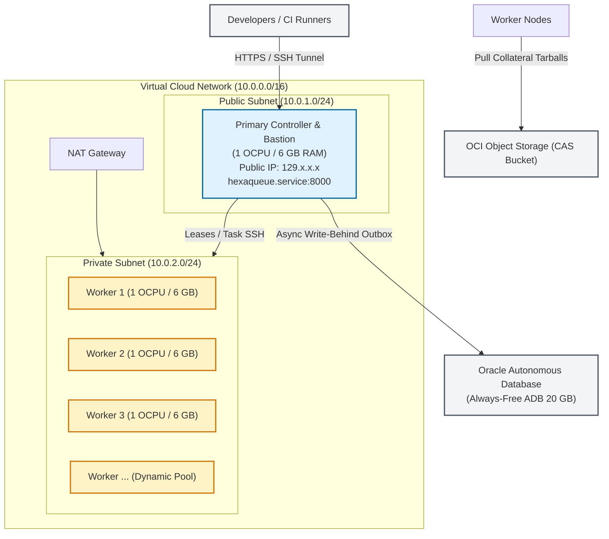

# OCI Always-Free Tier Production Runbook

This guide provides a comprehensive, production-grade runbook for provisioning, hardening, and deploying Hexaqueue onto Oracle Cloud Infrastructure (OCI) Always-Free Tier infrastructure (Ampere A1 ARM64 compute, Object Storage CAS, and systemd automation).

---

## 1. Architecture & Free-Tier Capacity Plan

Oracle Cloud Infrastructure provides a generous Always-Free Tier suitable for running high-throughput distributed test and mutation crunching:
- **Compute**: 4 OCPUs and 24 GB RAM across Ampere A1 ARM64 architecture (`VM.Standard.A1.Flex`).
- **Storage**: 200 GB total Block Volume capacity (shared across boot and block volumes) and 10 GB Always-Free Object Storage.
- **Database**: 2 Always-Free Oracle Autonomous Databases (ADB Serverless, 20 GB storage each) for durable cold-tier run history, job specifications, and telemetry persistence via an asynchronous write-behind outbox.
- **Networking**: 1 VCN with public and private subnets, internet gateway, and NAT gateway.



---

## 2. Infrastructure Provisioning

### Step 2.1: Virtual Cloud Network (VCN)
Create a VCN with the standard OCI wizard ("Create VCN with Internet Connectivity"):
- **VCN CIDR**: `10.0.0.0/16`
- **Public Subnet**: `10.0.1.0/24` (Hosts the Controller / Bastion VM)
- **Private Subnet**: `10.0.2.0/24` (Hosts Worker Instance Pool VMs)

#### Security List Rules:
1. **Public Subnet Ingress**:
   - TCP Port 22 (SSH): Restricted to your IP or zero-trust bastion.
   - TCP Port 8000 (Controller REST API): Public or VPN/Tailscale ingress.
2. **Private Subnet Ingress**:
   - TCP Port 22 & 8001 (Worker internal port): Allow from `10.0.1.0/24` (Public Subnet CIDR).
3. **Egress**:
   - Allow all outbound traffic via Internet Gateway (Public Subnet) and NAT Gateway (Private Subnet).

---

### Step 2.2: OCI Object Storage CAS Bucket
1. Open the OCI Console -> **Storage** -> **Buckets**.
2. Create a bucket named `hexaqueue-collateral` (or custom name).
3. Set default storage tier to **Standard**.
4. Configure bucket access policies to allow your worker VMs or Instance Principals read and write permissions to stage and retrieve test bundles.

---

### Step 2.3: Controller VM Provisioning
1. Launch an Ampere A1 Compute Instance (`VM.Standard.A1.Flex`):
   - **Shape**: 1 OCPU, 6 GB RAM.
   - **OS**: Ubuntu 24.04 LTS (aarch64) or Oracle Linux 9.
   - **Subnet**: Public Subnet.
   - **SSH Keys**: Add your administrator SSH public key.
2. Assign a Reserved Public IP to the instance to ensure a stable DNS/IP target.

---

## 3. Server Deployment & Systemd Configuration

Connect to the controller VM as the default user (`ubuntu`):

```bash
ssh ubuntu@<RESERVED_CONTROLLER_IP>
```

### Step 3.1: Install Prerequisites
```bash
sudo apt update && sudo apt install -y git curl build-essential python3-dev
curl -LsSf https://astral.sh/uv/install.sh | sh
source ~/.cargo/env
```

### Step 3.2: Clone Repository & Sync Dependencies
```bash
git clone https://github.com/TheTrueSCU/hexaqueue.git ~/hexaqueue
cd ~/hexaqueue
uv sync --all-packages --all-extras
```

### Step 3.3: Configure Production Systemd Unit (`hexaqueue.service`)

Create the systemd service file at `/etc/systemd/system/hexaqueue.service`:

```ini
[Unit]
Description=Hexaqueue Cluster Controller Daemon
After=network-online.target
Wants=network-online.target

[Service]
Type=simple
User=ubuntu
WorkingDirectory=/home/ubuntu/hexaqueue
Environment="HEXAQUEUE_CSP_PROVIDER=OCI"
Environment="HEXAQUEUE_WORKER_PORT=8001"
Environment="HEXAQUEUE_OCI_INSTANCE_POOL_ID=ocid1.instancepool.oc1.<region>.<example_instance_pool_ocid>"
Environment="HEXAQUEUE_COLLATERAL_BUCKET=hexaqueue-collateral"

# Optional: Auto-sync on startup
ExecStartPre=-/bin/bash -c "timeout 30s git fetch origin main && git reset --hard origin/main && git clean -fd && /home/ubuntu/.local/bin/uv sync --all-packages --all-extras"

ExecStart=/home/ubuntu/.local/bin/uv run hq server start --host 0.0.0.0 --port 8000
Restart=always
RestartSec=5

[Install]
WantedBy=multi-user.target
```

Enable and start the service:
```bash
sudo systemctl daemon-reload
sudo systemctl enable --now hexaqueue.service
```

Verify service status:
```bash
sudo systemctl status hexaqueue.service
sudo journalctl -u hexaqueue.service -f
```

---

## 4. Worker Instance Pool & Worker Daemon

For high-throughput execution, configure an OCI Instance Pool in the private subnet:

### Step 4.1: Worker Systemd Unit (`hexaqueue-worker.service`)

On worker VM images or cloud-init user-data, deploy `/etc/systemd/system/hexaqueue-worker.service`:

```ini
[Unit]
Description=Hexaqueue Execution Worker Daemon
After=network-online.target
Wants=network-online.target

[Service]
Type=simple
User=ubuntu
WorkingDirectory=/home/ubuntu/hexaqueue
Environment="HEXAQUEUE_SERVER_URL=http://10.0.1.X:8000"
Environment="HEXAQUEUE_WORKER_PORT=8001"
Environment="HEXAQUEUE_COLLATERAL_BUCKET=hexaqueue-collateral"

ExecStart=/home/ubuntu/.local/bin/uv run hq worker start --host 0.0.0.0 --port 8001
Restart=always
RestartSec=5

[Install]
WantedBy=multi-user.target
```

---

## 5. Operations & Troubleshooting Utilities

Hexaqueue ships with dedicated pure-Python operational tools in `scripts/ops/` runnable with `uv run` on the controller VM or over jump tunnels:

| Tool | Purpose | Command |
|---|---|---|
| **Cluster Journal** | Stream live controller journal logs | `uv run python scripts/ops/controller_journal.py` |
| **Worker SSH** | Jump-host SSH into private subnet (10.0.2.x) workers | `uv run python scripts/ops/worker_ssh.py <worker-private-ip>` |
| **Inspect Pool** | Query OCI Instance Pool sizing and active worker IPs | `uv run python scripts/ops/oci_inspect_pool.py` |
| **Pool Status** | High-level status dashboard of workers and tasks | `uv run python scripts/ops/pool_status.py` |
| **SSH Tunnel** | Establish secure local port-forwarding to cluster API | `uv run python scripts/ops/cluster_tunnel.py` |

---

## 6. Security & Invariant Checklist

- [x] **No Private Keys in Git**: Ensure `.env` and `.oci/*.pem` files remain uncommitted and git-ignored.
- [x] **Redacted Identifiers**: Documentation, logs, and public issues must redact all OCID strings, tenancy IDs, and authorization tokens.
- [x] **Strict Private Subnetting**: Worker nodes must never be assigned public IP addresses; they communicate through the NAT gateway and the controller bastion.
- [x] **Zero Test Runner Secrets**: External test runners require only `HEXAQUEUE_SERVER_URL` and `HEXAQUEUE_API_TOKEN`.
