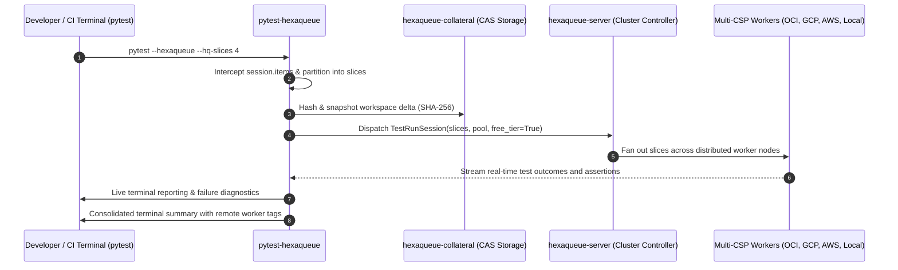
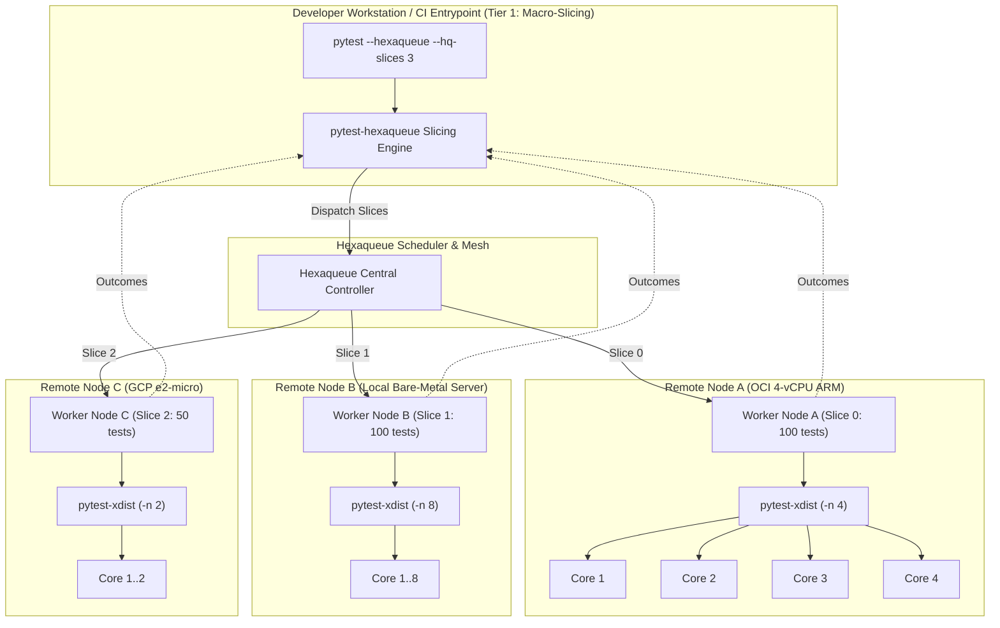

# Distributed Pytest Execution & Slicing Guide (`pytest-hexaqueue`)

> High-throughput distributed test execution, intelligent test suite slicing, and multi-cloud free-tier bursting with `pytest-hexaqueue`.

---

## 🎯 Overview

As test suites grow in size and complexity, local test execution becomes a major developer bottleneck. While single-machine parallelism helps, developers quickly hit the compute boundaries of their workstation or CI runner.

`pytest-hexaqueue` is a first-class `pytest` plugin that connects local or CI test execution directly to Hexaqueue clusters and federated **Multi-CSP Free-Tier Meshes** (Oracle Cloud Infrastructure, Google Cloud Platform, Amazon Web Services, Microsoft Azure, and local worker pools).



---

## ⚖️ Coexistence & Comparison: `pytest-hexaqueue` vs. `pytest-xdist`

A central architectural decision when adopting `pytest-hexaqueue` is how it interacts with the standard [`pytest-xdist`](https://github.com/pytest-dev/pytest-xdist) plugin. `pytest-hexaqueue` can be used **in place of** `pytest-xdist` for multi-machine scaling, or **alongside** `pytest-xdist` in a hybrid two-tier concurrency topology.

### 1. In Place of `pytest-xdist` (Multi-Node & Cloud-Native Scaling)

`pytest-xdist` is the standard for local multi-core parallelization (`pytest -n auto`). While `xdist` includes an SSH-based remote execution mode (`--tx ssh=...`), in practice it is brittle and difficult to manage across teams:
- Requires pre-configured SSH daemons on every remote worker.
- Requires identical virtual environments and absolute directory paths.
- Does not automate source code or diff synchronization.
- Lacks queueing, fair-share scheduling, preemption, or hardware isolation.
- Completely unaware of cloud compute budgets or free-tier quotas.

**`pytest-hexaqueue` replaces `pytest-xdist` for any workflow requiring multiple machines or cloud bursting:**

- **Zero-Configuration Workspace Delta Sync**: Using `hexaqueue-collateral`, uncommitted git diffs and modified files are content-addressed (SHA-256) into a CAS bundle and synchronized to worker nodes with zero overhead on unmodified files.
- **Multi-CSP Free-Tier Federation**: Tests can burst into free-tier compute quotas across multiple cloud providers (OCI 4-vCPU ARM, GCP e2-micro, AWS t4g.small, Azure B1s, and local nodes) with a mathematically verified $0.00 spend ceiling.
- **Enterprise Fair-Share Scheduling**: Test jobs participate in Hexaqueue's central scheduler, benefiting from priority aging, preemption, and compute placement affinity.
- **Transparent Local Fallback**: If the cluster is unreachable or offline, `--hq-fallback` (enabled by default) automatically runs the suite locally in-process without failing developer workflows.

```bash
# Slices the suite into remote partitions running on the Free-Tier mesh via profile
pytest --hexaqueue --hq-profile free-tier

# Or explicit one-off override
pytest --hexaqueue --hq-slices 6 --hq-free-tier
```

---

### 2. Alongside `pytest-xdist` (Two-Tier Hybrid Parallelism)

Rather than being mutually exclusive, `pytest-hexaqueue` and `pytest-xdist` operate at complementary levels of the concurrency hierarchy:

1. **Tier 1 (Macro-Level / Horizontal Partitioning)**: `pytest-hexaqueue` partitions the test suite across independent worker nodes, cloud instances, or container hosts.
2. **Tier 2 (Micro-Level / Vertical Parallelism)**: On each worker node, the runner executes its assigned slice across all available CPU cores using `pytest-xdist`.



In this hybrid topology:
- A developer runs `pytest --hexaqueue --hq-slices 4` locally.
- Hexaqueue dispatches the 4 slices to 4 remote worker nodes.
- Each worker container or process runs `pytest <slice_items> -n auto`, fully saturating all vCPUs on each host.

---

### 3. Comparison Matrix

| Dimension | `pytest-xdist` | `pytest-hexaqueue` | Combined (Hybrid) |
|---|---|---|---|
| **Primary Scope** | Local multi-core subprocesses (`-n N`) | Multi-node & Multi-CSP remote cluster (`--hq-slices N`) | Multi-node slices + multi-core execution per node |
| **Compute Topology** | Single machine (SSH mode manual/unsupported in practice) | Federated multi-CSP mesh (OCI, GCP, AWS, Azure, Local) | Cloud cluster nodes saturated with local worker processes |
| **Workspace & Code Sync** | Requires shared filesystem or identical directory layout | Content-addressed SHA-256 CAS delta sync | CAS sync to host, executed across cores |
| **Budget & Cost Safety** | Unaware of cloud costs or quotas | Enforced $0.00 Free-Tier ceiling via Governor | Free compute pooled with local multi-core utilization |
| **Scheduling Intelligence** | Local round-robin / load-balancing | Fair-share, priority aging, compute placement affinity | Cluster scheduling + local worker core distribution |
| **Node Failure Resilience** | Crashed worker fails entire test run | Automatic rescheduling or local fallback | Node failure quarantined away from developer machine |
| **Terminal Reporting** | Aggregates local worker subprocesses | Live streaming telemetry + multi-CSP node annotations | Unified terminal summary with remote node origins |

---

## ⚙️ Slicing Algorithms

`pytest-hexaqueue` supports multiple test partitioning algorithms configured via `--hq-slicer`:

### Round-Robin Slicer (`--hq-slicer round-robin`, default)
Partitions collected test node IDs cyclically across slices ($item_i \to slice_{i \pmod N}$).
- **Optimal for**: Evenly distributed test suites where individual tests have roughly similar runtimes.
- **Advantage**: Maximizes file interleave to balance runtime when single test files are unusually long.

### File-Contiguous Slicer (`--hq-slicer file`)
Groups tests located in the same file into the same slice as much as possible before spilling over to the next slice.
- **Optimal for**: Suites with expensive module-scoped fixtures (e.g. database setup, Docker containers), minimizing redundant setup/teardown costs across workers.
- **Advantage**: Preserves fixture locality and reduces remote process warmup overhead.

---

## 🚀 Practical Usage & CI Recipes

### 1. Developer Workstation Quickstart

Run tests distributed using project defaults configured in `pyproject.toml` or `hexaqueue.yaml`:

```bash
pytest --hexaqueue
```

Switch execution environments instantly using named profiles:

```bash
# Isolated OCI container sandbox slices
pytest --hexaqueue --hq-profile container

# Federated zero-cost Multi-CSP cloud mesh ($0.00 spend ceiling)
pytest --hexaqueue --hq-profile free-tier

# Explicit CLI overrides for one-off experimentation
pytest --hexaqueue --hq-slices 8 --hq-slicer file
```

### 2. Configuration via `pyproject.toml` or `hexaqueue.yaml`

Configure project defaults and named profiles in `pyproject.toml` under `[tool.hexaqueue]`. This eliminates flag clutter across developer environments and CI:

```toml
[tool.hexaqueue]
server_url = "http://127.0.0.1:8000"
slices = 4
slicer = "round-robin"
fallback = true
mode = "subprocess"

[tool.hexaqueue.profiles.container]
mode = "container"
slices = 4
container = { image = "hexaqueue-worker:latest", runtime = "auto" }

[tool.hexaqueue.profiles.ci]
server_url = "https://hq-cluster.corp.internal"
slices = 16
fallback = false

[tool.hexaqueue.profiles.free-tier]
free_tier = true
slices = 4
pool = "arm64-always-free"
```

You can also set default pytest arguments in `[tool.pytest.ini_options]`:

```toml
[tool.pytest.ini_options]
addopts = "--hexaqueue"
markers = [
    "hexaqueue: mark test for execution on Hexaqueue distributed cluster",
]
```

### 3. GitHub Actions CI Matrix Offloading

Instead of maintaining expensive GitHub Actions matrix jobs, dispatch all test slices through a single lightweight GitHub Actions runner targeting the `ci` profile:

```yaml
name: Test Suite
on: [push, pull_request]

jobs:
  test:
    runs-on: ubuntu-latest
    steps:
      - uses: actions/checkout@v4
      - uses: astral-sh/setup-uv@v3

      - name: Run Distributed Tests via Hexaqueue
        env:
          HEXAQUEUE_SERVER_URL: ${{ secrets.HEXAQUEUE_SERVER_URL }}
          HEXAQUEUE_API_TOKEN: ${{ secrets.HEXAQUEUE_API_TOKEN }}
        run: |
          uv run pytest --hexaqueue --hq-profile ci
```

---

## 🛠️ CLI Reference

Layered resolution order: **CLI flags (highest)** $\to$ **Environment variables** $\to$ **Active named profile (`--hq-profile`)** $\to$ **Config file (`pyproject.toml` / `hexaqueue.yaml`)** $\to$ **Built-in defaults (lowest)**.

| Flag | Env Var | Default | Description |
|---|---|---|---|
| `--hexaqueue` | `HEXAQUEUE_PYTEST` | `False` | Enable Hexaqueue distributed test execution |
| `--hq-config` | `HEXAQUEUE_CONFIG` | None | Explicit path to configuration file (`pyproject.toml` or `hexaqueue.yaml`) |
| `--hq-profile` | `HEXAQUEUE_PROFILE` | None | Active configuration profile name (e.g., `ci`, `container`, `free-tier`) |
| `--hq-server` | `HEXAQUEUE_SERVER_URL` | Config / `http://127.0.0.1:8000` | Hexaqueue cluster controller base URL |
| `--hq-token` | `HEXAQUEUE_API_TOKEN` | None | Authentication bearer token for cluster access |
| `--hq-slices` | `HEXAQUEUE_SLICES` | Config / `4` | Number of parallel execution slices to partition the suite into |
| `--hq-container` | `HEXAQUEUE_CONTAINER` | Config / `False` | Execute slices inside isolated OCI container sandboxes |
| `--hq-image` | `HEXAQUEUE_WORKER_IMAGE` | Config / `latest` | Container image tag for worker runtime |
| `--hq-pool` | `HEXAQUEUE_POOL` | Config / `default` | Target compute instance pool for runner placement |
| `--hq-paid` | `HEXAQUEUE_PAID` | Config / `False` | Authorize paid cloud compute (disables zero-cost free-tier guardrails) |
| `--hq-free-tier` | `HEXAQUEUE_FREE_TIER` | Config / `True` | Enforce zero-cost Multi-CSP Free-Tier mesh execution ($0.00 spend ceiling) |
| `--hq-fallback` | `HEXAQUEUE_LOCAL_FALLBACK` | Config / `True` | Fall back to local in-process execution if cluster is unreachable |
| `--hq-slicer` | `HEXAQUEUE_SLICER` | Config / `round-robin` | Test partitioning algorithm: `round-robin` or `file` |
