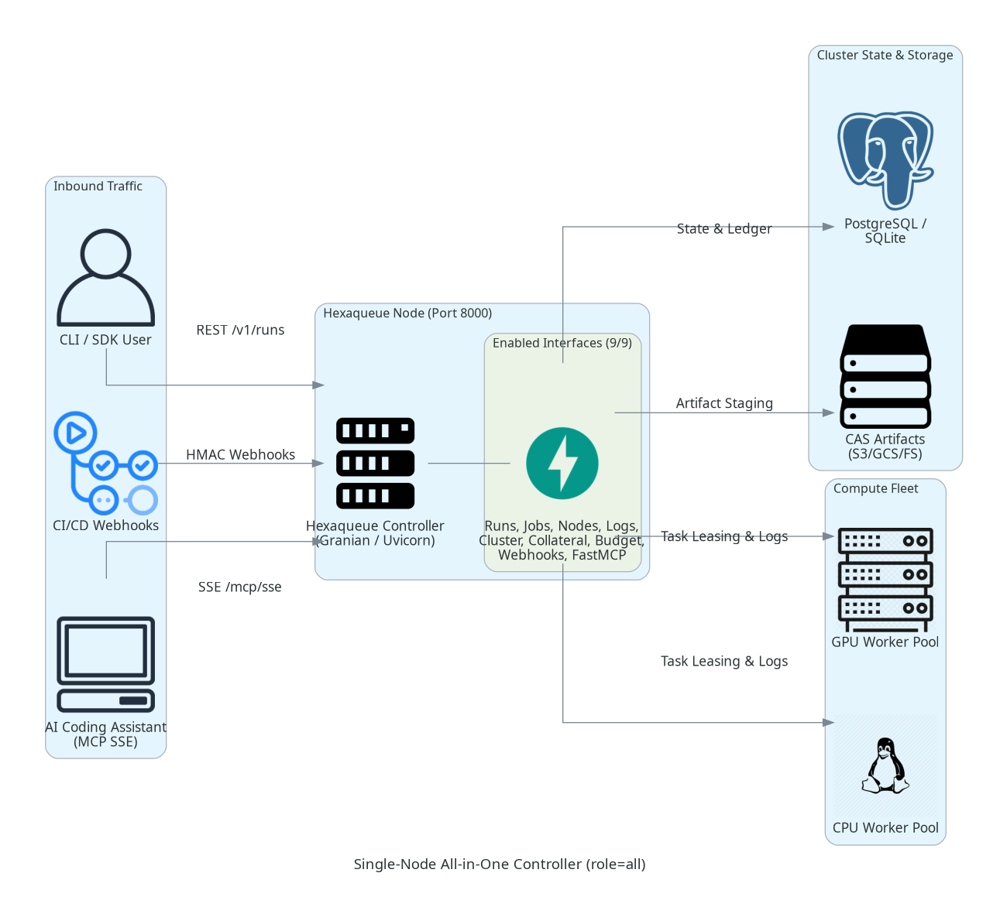
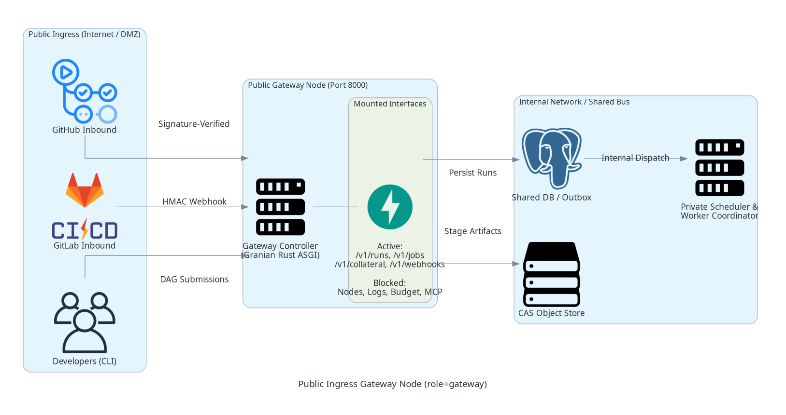
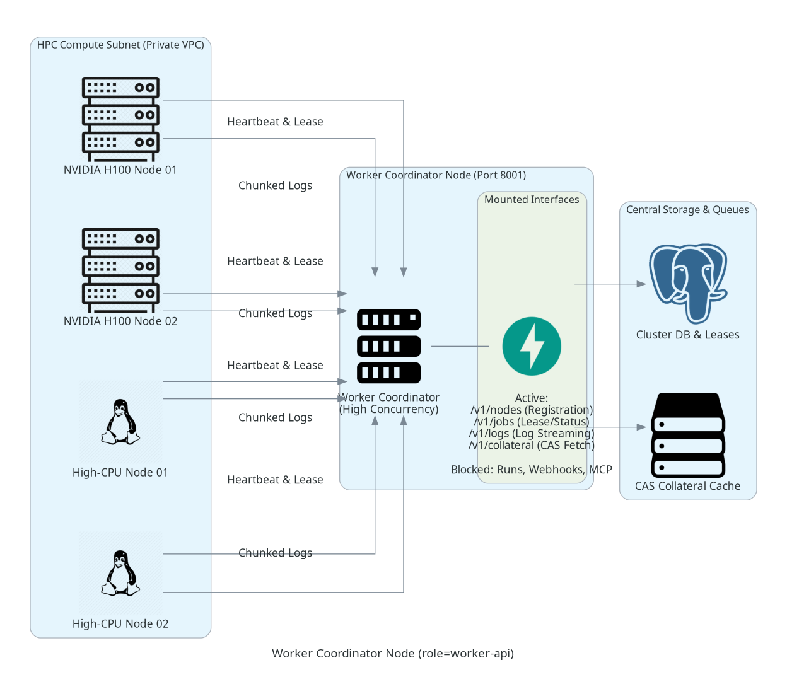
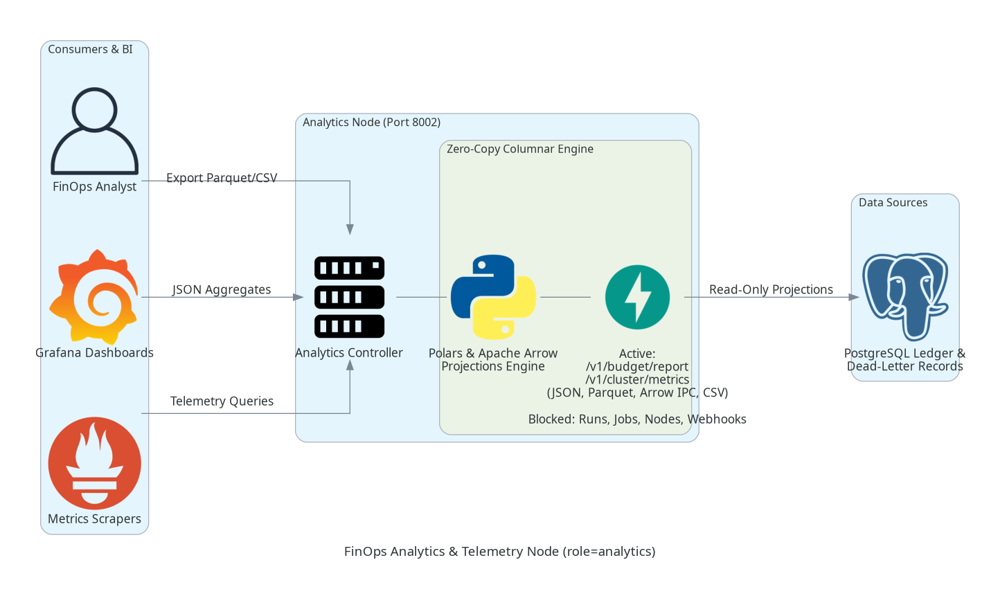
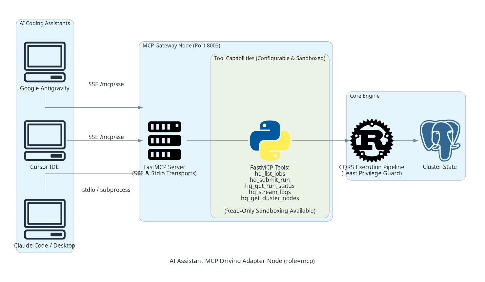
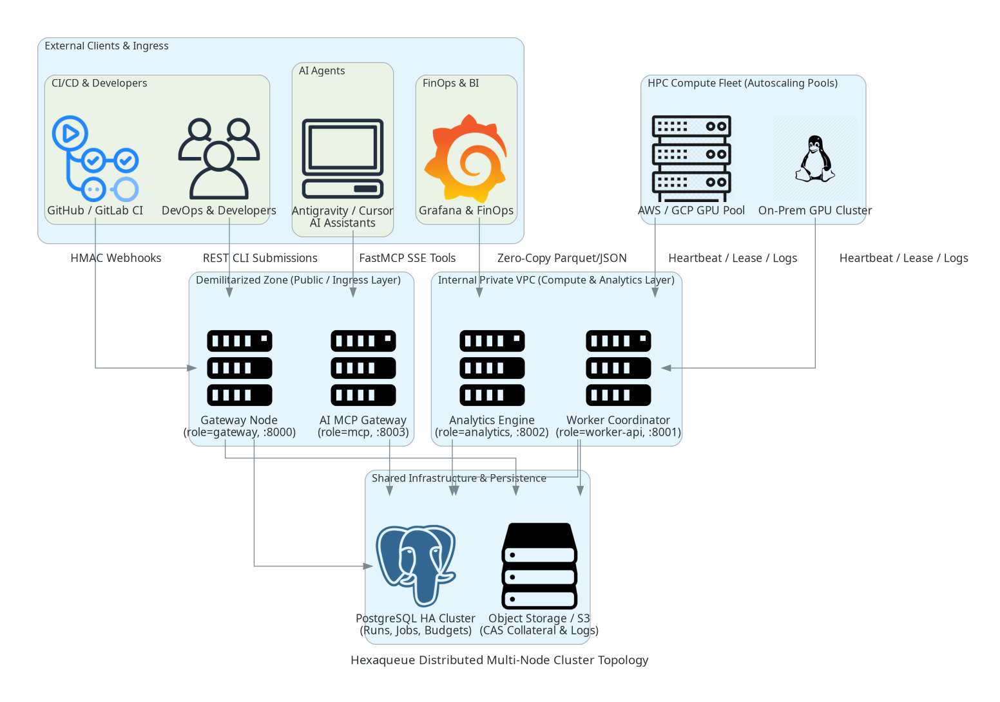

# Hexaqueue Server Topologies & Configuration Guide

> **Architectural Overview**: How Hexaqueue decouples public ingress, worker coordination, FinOps analytics, and AI assistant interfaces into modular, mix-and-match server deployment roles.

---

## 1. Architectural Philosophy: The Decoupled Control Plane

In large-scale HPC batch scheduling and multi-tenant ML engineering, running a monolithic scheduler controller presents severe operational liabilities:
- **Security Exposure**: Exposing worker node registration (`/v1/nodes`) or internal log streams on public endpoints creates an attack surface in public DMZs.
- **FinOps Contention**: Running heavy analytical spend projections or columnar Parquet exports on the same thread loop as millisecond-critical task leasing causes latency spikes.
- **AI Sandboxing**: Modern AI pair-programming assistants (Antigravity CLI, Cursor IDE, Claude Code) require tool access to query jobs and stream traces without having permission to leak compute secrets or hijack worker leases.

Hexaqueue solves this by structuring all HTTP and RPC entrypoints into **9 granular interface switches** under a unified [CQRS Execution Pipeline](file:///home/rjdw/Projects/hexaqueue/packages/hexaqueue_server/src/hexaqueue_server/infra/cqrs/pipeline.py):

| Interface Switch | Purpose | Primary Endpoints |
|---|---|---|
| `runs` | Pipeline run & DAG submission | `/v1/runs`, `/v1/suites` |
| `jobs` | Job lifecycle operations (cancel, pause, explain) | `/v1/jobs` |
| `nodes` | Worker node registration & heartbeat telemetry | `/v1/nodes`, `/v1/nodes/profiles` |
| `logs` | Real-time chunked log streaming & presigned URLs | `/v1/jobs/{job_id}/logs` |
| `cluster` | Cluster statistics, fairshare, and DLQ diagnostics | `/v1/cluster/stats`, `/v1/dlq` |
| `collateral` | Content-Addressable Storage (CAS) ingestion | `/v1/collateral/ingest`, `/v1/collateral/manifest` |
| `budget` | FinOps credit reservation, balance, and settlement | `/v1/budget/reserve`, `/v1/budget/report` |
| `webhooks` | Signature-verified CI/CD inbound receivers | `/v1/webhooks/github`, `/v1/webhooks/gitlab` |
| `mcp` | Model Context Protocol driving adapter (SSE & stdio) | `/mcp/sse`, `/mcp/messages` |

---

## 2. Server Operational Roles & Topologies

Hexaqueue ships with pre-configured **Server Roles** (`all`, `gateway`, `worker-api`, `analytics`, `mcp`, `custom`). Each role configures default interface boundaries with zero boilerplate while supporting fine-grained mix-and-match overrides.

---

### Setup 1: Monolithic All-in-One Controller (`role = "all"`)

For local development, single-server staging, or small on-premises teams, Hexaqueue runs all 9 interfaces in a single process.



#### Interface Matrix
- **Enabled (9/9)**: `runs`, `jobs`, `nodes`, `logs`, `cluster`, `collateral`, `budget`, `webhooks`, `mcp`
- **Engine**: Granian (Rust ASGI) or Uvicorn

#### Command Line
```bash
# Start all interfaces using high-performance Granian Rust ASGI engine
hq server start --role all --engine granian --port 8000
```

#### Declarative Configuration (`hexaqueue.toml`)
```toml
[server]
role = "all"
engine = "granian"
host = "0.0.0.0"
port = 8000
workers = 4
```

---

### Setup 2: Public Ingress Gateway (`role = "gateway"`)

Positioned in a public DMZ or behind a cloud load balancer (ALB / Ingress-Nginx). Accepts GitHub and GitLab webhook events, verifies HMAC signatures, accepts developer pipeline submissions, and stages collateral artifacts. Completely isolates internal compute node endpoints.



#### Interface Matrix
- **Enabled**: `runs`, `jobs`, `collateral`, `webhooks`
- **Blocked**: `nodes`, `logs`, `cluster`, `budget`, `mcp`

#### Command Line
```bash
# Start public gateway node
hq server start --role gateway --port 8000 --engine granian
```

#### Declarative Configuration (`hexaqueue.toml`)
```toml
[server]
role = "gateway"
engine = "granian"
host = "0.0.0.0"
port = 8000

[server.interfaces]
runs = true
jobs = true
collateral = true
webhooks = true
nodes = false
logs = false
cluster = false
budget = false
mcp = false
```

---

### Setup 3: Dedicated Worker Coordinator (`role = "worker-api"`)

Deployed inside a private VPC or high-speed InfiniBand subnet directly adjacent to HPC compute instances (NVIDIA H100s, EPYC CPU nodes). Handles worker registration, millisecond-latency task leasing, and high-throughput chunked log streaming without interference from public HTTP traffic.



#### Interface Matrix
- **Enabled**: `jobs`, `nodes`, `logs`, `collateral`
- **Blocked**: `runs`, `cluster`, `budget`, `webhooks`, `mcp`

#### Command Line
```bash
# Start private worker coordinator on port 8001
hq server start --role worker-api --port 8001 --workers 8
```

#### Declarative Configuration (`hexaqueue.toml`)
```toml
[server]
role = "worker-api"
engine = "uvicorn"
host = "10.0.1.10"
port = 8001
workers = 8
```

---

### Setup 4: FinOps Analytics & Columnar Telemetry Engine (`role = "analytics"`)

Dedicated to business intelligence, cost allocation, and audit reporting. Powered by [Polars](https://pola.rs) and Apache Arrow, this node generates zero-copy in-memory projections of spend by tenant, burn rates, utilization percentiles, and dead-letter queue trends, exporting directly to Parquet, Arrow IPC, CSV, or JSON.



#### Interface Matrix
- **Enabled**: `cluster`, `budget`
- **Blocked**: `runs`, `jobs`, `nodes`, `logs`, `collateral`, `webhooks`, `mcp`

#### Command Line
```bash
# Start dedicated analytics engine
hq server start --role analytics --port 8002
```

#### Declarative Configuration (`hexaqueue.toml`)
```toml
[server]
role = "analytics"
engine = "uvicorn"
host = "10.0.2.15"
port = 8002

[server.interfaces]
cluster = true
budget = true
runs = false
jobs = false
nodes = false
logs = false
collateral = false
webhooks = false
mcp = false
```

#### Analytical Query Examples
```bash
# 1. Zero-copy Parquet streaming export of 7-day tenant spend
curl -s "http://analytics-host:8002/v1/budget/report?window_hours=168&format=parquet" -o budget_7d.parquet

# 2. Apache Arrow IPC stream for Python/Pandas/Polars data science consumers
curl -s "http://analytics-host:8002/v1/cluster/metrics?window_hours=24&format=arrow_ipc" -o cluster_24h.arrow
```

---

### Setup 5: Dedicated AI Assistant MCP Node (`role = "mcp"`)

Exposes Hexaqueue's CQRS command and query bus to AI coding assistants (Google Antigravity, Cursor IDE, Claude Code) over the Model Context Protocol (MCP). Supports Server-Sent Events (SSE) over HTTP or direct local subprocess stdio communication.



#### Interface Matrix
- **Enabled**: `mcp` (HTTP Server-Sent Events at `/mcp/sse`)
- **Blocked**: REST API surfaces (pure MCP node)

#### Command Line
```bash
# 1. Run as a dedicated network-accessible MCP server
hq server start --role mcp --port 8003

# 2. Run over local stdio with read-only sandboxing (for Antigravity / Cursor)
hq mcp run --read-only --tools "list_jobs,get_run_status,stream_logs"
```

#### Declarative Configuration (`hexaqueue.toml`)
```toml
[server]
role = "mcp"
host = "0.0.0.0"
port = 8003

[server.mcp]
enabled = true
path_prefix = "/mcp"
sse_path = "/sse"
auth_token = "secret-mcp-bearer-token"
read_only = true

[server.mcp.tools]
list_jobs = true
get_run_status = true
get_cluster_nodes = true
stream_logs = true
submit_run = false
lease_task = false
```

---

### Setup 6: Distributed Enterprise Cluster (Mix-and-Match)

In enterprise deployments, specialized nodes run across isolated network tiers, communicating via a shared database, message bus, and object store:



#### Cluster Node Setup Reference
```bash
# Node 1: Public Gateway in DMZ (Webhook + DAG Ingress + Optional Developer MCP)
hq server start --role gateway --mcp --port 8000

# Node 2: Internal HPC Worker Coordinator in Private Subnet
hq server start --role worker-api --port 8001 --workers 16

# Node 3: FinOps & Grafana Columnar Telemetry Engine
hq server start --role analytics --port 8002

# Node 4: Isolated AI Assistant Gateway with Read-Only Sandboxing
hq server start --role mcp --config /etc/hexaqueue/mcp-readonly.toml --port 8003
```

---

## 3. Mix-and-Match CLI Controls & Overrides

Any deployment role can be dynamically customized via command-line flags without modifying configuration files:

### Fine-Grained Interface Selection (`--interfaces`)
```bash
# Run only runs, jobs, and MCP on a single node
hq server start --interfaces "runs,jobs,mcp" --port 8080
```

### Dedicated MCP Gating (`--mcp` / `--no-mcp`)
```bash
# Add MCP to a gateway node
hq server start --role gateway --mcp

# Disable MCP on an all-in-one node
hq server start --role all --no-mcp
```

### Configuration File Loading (`--config` / `-c`)
```bash
# Load base configuration from TOML with CLI overrides
hq server start --config /etc/hexaqueue/server.toml --port 9000 --engine granian
```

---

## 4. Dynamic Feature Flags & Environment Variables

Hexaqueue supports zero-downtime interface gating via container environment variables and external feature flag engines (Flagd, OpenFeature).

### Supported Environment Variables

| Variable | Values | Effect |
|---|---|---|
| `HQ_INTERFACE_MCP` | `true`, `false`, `1`, `0` | Globally enables or disables the MCP driving adapter |
| `HQ_INTERFACE_RUNS` | `true`, `false`, `1`, `0` | Gating for `/v1/runs` and `/v1/suites` |
| `HQ_INTERFACE_WEBHOOKS` | `true`, `false`, `1`, `0` | Gating for inbound CI/CD webhook receivers |
| `HQ_INTERFACE_NODES` | `true`, `false`, `1`, `0` | Gating for worker node registration |
| `HQ_INTERFACE_BUDGET` | `true`, `false`, `1`, `0` | Gating for budget accounting endpoints |
| `HQ_MCP_ENABLED` | `true`, `false`, `1`, `0` | Overrides MCP adapter enablement |
| `HQ_MCP_READ_ONLY` | `true`, `false`, `1`, `0` | Enforces read-only sandboxing across all MCP tools |
| `HQ_MCP_AUTH_TOKEN` | string | Enforces Bearer token authentication on `/mcp/sse` |

### Progressive Gating Example
```bash
# Instantly disable MCP and public webhooks on a running node without code changes
export HQ_INTERFACE_MCP="false"
export HQ_INTERFACE_WEBHOOKS="false"
hq server start --role gateway
```

---

## 5. Summary & Best Practices

1. **Never expose `worker-api` to the public internet**: Protect `/v1/nodes` and `/v1/jobs` behind internal load balancers.
2. **Use Granian for I/O heavy ingress**: Inbound webhook processing and DAG submissions benefit from Granian's Rust HTTP pipeline (`--engine granian`).
3. **Isolate FinOps queries**: Heavy analytical spend aggregation should run on dedicated `analytics` nodes to prevent scheduler CPU starvation.
4. **Enforce Read-Only MCP for external assistants**: Use `read_only = true` or `hq mcp run --read-only` to prevent unintended task scheduling or lease claims by autonomous agents.
