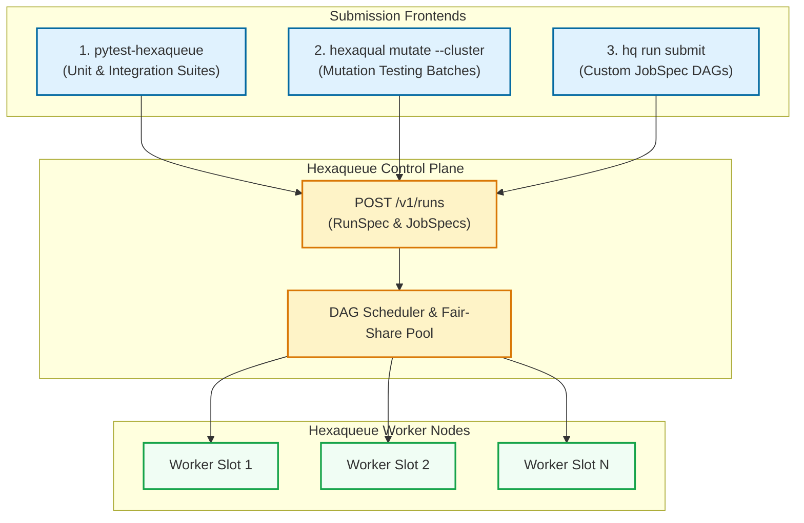

# Workload Submission & Execution Guide

This guide describes how to submit workloads, offload test suites, and execute parallel mutation testing jobs against a Hexaqueue cluster.

---

## 1. Workload Submission Modalities

Hexaqueue provides three primary ways to run work across a cluster:



---

## 2. Distributed Test Execution (`pytest-hexaqueue`)

The `pytest-hexaqueue` plugin automatically partitions pytest test collections into balanced slices and executes them concurrently across remote worker slots.

### Quick Command:
```bash
# 1. Point to your Hexaqueue server
export HEXAQUEUE_SERVER_URL="https://hexaqueue.example.com"
export HEXAQUEUE_API_TOKEN="<your-auth-token>"

# 2. Run pytest with remote execution across 8 slices
pytest --hexaqueue --hq-slices 8
```

### Key Plugin Options:
| Flag | Description | Default |
|---|---|---|
| `--hexaqueue` | Activates the Hexaqueue pytest distributed plugin. | `False` |
| `--hq-server <url>` | Overrides the cluster REST endpoint URL. | `HEXAQUEUE_SERVER_URL` |
| `--hq-token <token>` | Hexaqueue bearer authentication token. | `HEXAQUEUE_API_TOKEN` |
| `--hq-slices <n>` | Number of parallel test slices to partition test cases across. | `4` |
| `--hq-fallback` | Automatically execute tests locally if cluster is unreachable. | `True` |
| `--hq-profile <name>` | Select named execution profile configured in `pyproject.toml`. | `default` |

---

## 3. Distributed Mutation Testing (`hexaqual mutate --cluster`)

Mutation testing creates modified variants ("mutants") of your source code to measure whether your test suite detects artificial faults. Because mutation testing can require evaluating hundreds or thousands of test runs, offloading mutation batches to Hexaqueue scales crunching linearly with cluster capacity.

### Running Scoped Mutation on Cluster:
```bash
# Offload mutation testing for a specific package to the Hexaqueue cluster
uv run hexaqual mutate run \
  -p core \
  -e gremlins \
  -w auto \
  --batch-size 10 \
  -n auto \
  --cluster hexaqueue
```

### Git Diff Scoping with `--direct-only`:
In CI pull requests, run mutation testing exclusively on packages directly touched by git diffs:
```bash
uv run hexaqual mutate run \
  -A \
  --direct-only \
  -e gremlins \
  --cluster hexaqueue
```

---

## 4. Submitting Arbitrary JobSpec DAGs (`hq run submit`)

For generic batch workflows, pipeline DAGs, and simulations, construct a YAML or JSON run specification defining tasks, dependencies, resource requests, and environment variables.

### Example Run Specification (`pipeline.yaml`):
```yaml
run_spec:
  id: "data-pipeline-01"
  name: "ETL & Model Validation"
  tags: ["env:production", "tier:batch"]

jobs:
  - id: "extract"
    name: "Extract Raw Data"
    command: "python"
    args: ["scripts/extract.py", "--source", "s3"]
    resources:
      cpus: 2
      ram_mb: 2048

  - id: "transform-part-1"
    name: "Transform Partition 1"
    command: "python"
    args: ["scripts/transform.py", "--partition", "1"]
    resources:
      cpus: 4
      ram_mb: 4096

  - id: "transform-part-2"
    name: "Transform Partition 2"
    command: "python"
    args: ["scripts/transform.py", "--partition", "2"]
    resources:
      cpus: 4
      ram_mb: 4096

  - id: "aggregate"
    name: "Aggregate Final Metrics"
    command: "python"
    args: ["scripts/aggregate.py"]
    resources:
      cpus: 2
      ram_mb: 2048

dependencies:
  "transform-part-1": ["extract"]
  "transform-part-2": ["extract"]
  "aggregate": ["transform-part-1", "transform-part-2"]
```

### Submitting the Pipeline:
```bash
# Submit and stream execution progress in real time
hq run submit pipeline.yaml --stream
```

---

## 5. Monitoring & Observability

### Cluster Health & Worker Inventory:
```bash
# Check overall cluster status and connection health
hq status

# View real-time cluster worker slots, CPU, and memory utilization
hq cluster top
```

### Live Log Streaming & Run Inspection:
```bash
# Stream live stdout/stderr for a specific running task
hq run logs <run-id> -f

# Inspect detailed status, error codes, and step outputs
hq run get <run-id>
```
