# ⚡ `hexaqueue` (Umbrella Metapackage)

> Unified distribution providing turnkey installation and multi-component orchestration for Hexaqueue.

[](https://pypi.org/project/hexaqueue/)
[](https://www.python.org/downloads/)
[](https://codecov.io/github/TheTrueSCU/hexaqueue)
[](https://dopplereffect.us/hexaqueue/)
[](https://dopplereffect.us/hexastack/)
[](https://dopplereffect.us/hexaqual/)
[](https://dopplereffect.us/hexaqueue/)
[](../../LICENSE)

> Part of the [**Hexaqueue Scheduler**](https://dopplereffect.us/hexaqueue/) · Built on [**Hexastack**](https://dopplereffect.us/hexastack/) · Governed by [**Hexaqual**](https://dopplereffect.us/hexaqual/).

---

## 🏗️ Architecture & Dependencies

```mermaid
graph TD
    subgraph S1["hexaqueue (Umbrella Metapackage)"]
        META["hexaqueue"]
    end

    subgraph S2["Hexaqueue Workspace Packages"]
        HQ_CLI["hexaqueue-cli"]
        HQ_COLLATERAL["hexaqueue-collateral"]
        HQ_CORE["hexaqueue-core"]
        HQ_DASHBOARD["hexaqueue-dashboard"]
        HQ_GITHUB["hexaqueue-github-runner"]
        HQ_GITLAB["hexaqueue-gitlab-runner"]
        HQ_KUEUE["hexaqueue-kueue"]
        HQ_MONITOR["hexaqueue-monitor"]
        HQ_SCANNER["hexaqueue-scanner"]
        HQ_SERVER["hexaqueue-server"]
        HQ_WORKER["hexaqueue-worker"]
        HQ_WORKFLOW["hexaqueue-workflow"]
        PYTEST_HQ["pytest-hexaqueue"]
    end

    META --> HQ_CLI
    META --> HQ_COLLATERAL
    META --> HQ_CORE
    META --> HQ_DASHBOARD
    META --> HQ_GITHUB
    META --> HQ_GITLAB
    META --> HQ_KUEUE
    META --> HQ_MONITOR
    META --> HQ_SCANNER
    META --> HQ_SERVER
    META --> HQ_WORKER
    META --> HQ_WORKFLOW
    META --> PYTEST_HQ
```



---

## 🚀 Installation & Extras

Install the unified distribution (`pip install hexaqueue` installs all workspace subpackages by default):

```bash
# Full workspace distribution (all subpackages included)
pip install hexaqueue

# With Oracle Cloud Infrastructure (OCI) elastic instance pool & object storage
pip install hexaqueue[oci]

# With GitHub Actions dynamic runner autoscaler
pip install hexaqueue[github]

# With GCP or Oracle Autonomous Database adapters
pip install hexaqueue[gcp,oracle]

# With .env loader or Sentry worker telemetry
pip install hexaqueue[dotenv,sentry]
```

---

## 💻 Namespace Usage

The umbrella package discovers and exposes installed subpackages dynamically under the top-level `hexaqueue` namespace:

```python
import hexaqueue

# Core scheduling primitives and domain models
from hexaqueue.core.domain.job import JobSpec
from hexaqueue.core.domain.resources import ResourceRequirements

# GitHub Actions runner autoscaler & webhook adapter
from hexaqueue.github_runner import (
    DynamicGitHubRunnerAutoscaler,
    GitHubWebhookAdapter,
    LabelTranslator,
)

# Interactive CLI entrypoint
from hexaqueue.cli.main import app as cli_app
```
