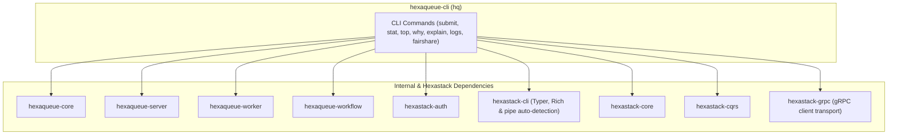

# 💻 `hexaqueue-cli`

> Modern interactive developer and operator terminal CLI (`hq`).

> Part of the [**Hexaqueue Scheduler**](https://dopplereffect.us/hexaqueue/) · Built on [**Hexastack**](https://dopplereffect.us/hexastack/) · Governed by [**Hexaqual**](https://dopplereffect.us/hexaqual/).

---

## 🏗️ Architecture & Dependencies

---

## 🛠️ Command Groups & Top-Level Commands

| Command / Group | Description |
|---|---|
| `hq submit` / `hq status` / `hq logs` / `hq top` | Quick pipeline submission, run/job status inspection, log tailing, and live monitor |
| `hq jobs` / `hq list` / `hq cancel` / `hq hold` / `hq release` | Job listing and lifecycle state controls |
| `hq why` / `hq explain` / `hq fairshare` / `hq quota` / `hq stat` | Scheduling explainability, pending diagnostics, and tenant quota views |
| `hq exec` / `hq attach` / `hq nodes` | Interactive PTY execution and compute node inspection |
| `hq admin` | Cluster administration operations |
| `hq auth` | Authentication and token/identity utilities |
| `hq cluster` | Cluster `status`, `ping`, `tunnel`, `sync`, `discover`, `journal`, and `pool` management |
| `hq collateral` | Content-addressed workspace collateral upload and cache management |
| `hq dashboard` | Launch and manage the operator web dashboard (`hexaqueue-dashboard`) |
| `hq mcp` | Expose or run the Model Context Protocol (`MCP`) server adapter |
| `hq node` | Worker node `list` and zero-trust `ssh` diagnostics |
| `hq run` | Multi-stage YAML pipeline `submit`, `list`, and `cancel` commands |
| `hq scanner` (alias: `scan`) | Security artifact scanning and quarantine inspection |
| `hq server` | Start and manage the central controller daemon (`hq server start`) |
| `hq suite` | Test suite submission and management |
| `hq workflow` | Hexaflow workflow execution and DAG orchestration subcommands |
