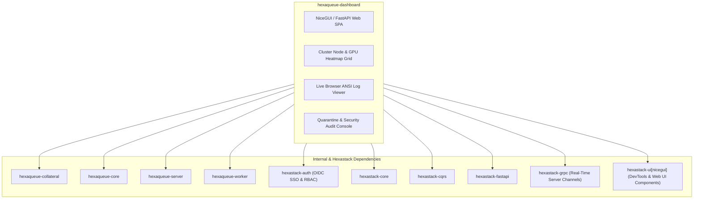

# 🖥️ `hexaqueue-dashboard`

> Modern web portal, cluster heatmap visualizer, live terminal log viewer, and operator console.

> Part of the [**Hexaqueue Scheduler**](https://dopplereffect.us/hexaqueue/) · Built on [**Hexastack**](https://dopplereffect.us/hexastack/) · Governed by [**Hexaqual**](https://dopplereffect.us/hexaqual/).

---

## 🏗️ Architecture & Dependencies

