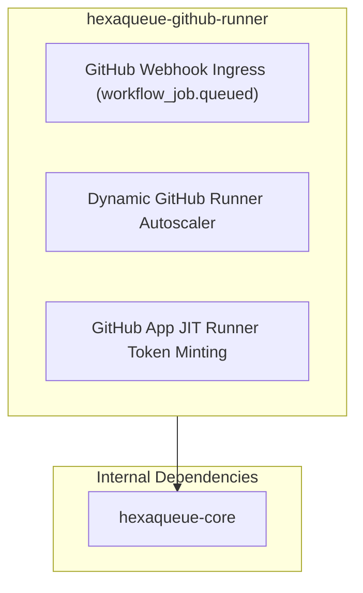

# 🐙 `hexaqueue-github-runner`

> GitHub Actions Dynamic Self-Hosted Runner Autoscaler & Webhook Bridge.

[](https://pypi.org/project/hexaqueue-github-runner/)
[](https://www.python.org/downloads/)
[](https://codecov.io/github/TheTrueSCU/hexaqueue)
[](https://dopplereffect.us/hexaqueue/)
[](https://dopplereffect.us/hexastack/)
[](https://dopplereffect.us/hexaqual/)
[](../../LICENSE)

> Part of the [**Hexaqueue Scheduler**](https://dopplereffect.us/hexaqueue/) · Built on [**Hexastack**](https://dopplereffect.us/hexastack/) · Governed by [**Hexaqual**](https://dopplereffect.us/hexaqual/).

---

## 🏗️ Architecture & Dependencies



---

## 🚀 Quickstart & Usage

### 1. Ingress Webhook Router Setup (FastAPI)

```python
from fastapi import FastAPI
from hexaqueue_github_runner import (
    DynamicGitHubRunnerAutoscaler,
    GitHubApiClient,
    GitHubAppCredentials,
    GitHubWebhookAdapter,
    HmacSha256WebhookVerifier,
    create_github_webhook_router,
)

app = FastAPI()

credentials = GitHubAppCredentials(
    app_id="123456",
    installation_id=7890,
    private_key_pem="<PEM_ENCODED_APP_PRIVATE_KEY>",
)
api_client = GitHubApiClient(credentials=credentials)
autoscaler = DynamicGitHubRunnerAutoscaler(api_client=api_client)
verifier = HmacSha256WebhookVerifier()

adapter = GitHubWebhookAdapter(
    verifier=verifier,
    autoscaler=autoscaler,
    secret="your-github-webhook-secret",
)

# Mount webhook route at /webhooks/github
app.include_router(create_github_webhook_router(adapter))
```

### 2. Supported Runner Labels

Hexaqueue translates GitHub Actions `runs-on` labels dynamically:
- `runs-on: [self-hosted, linux, 16-cores, 64gb, gpu-h100, 100gb-scratch, 2h-walltime]`
- CPU: `16-cores`, `cpu-8`, `4-cpu`
- RAM: `64gb`, `ram-32gb`
- GPU: `gpu-h100`, `a100`, `l4`, `t4`, `v100`, `4-gpu-a100`
- Scratch: `100gb-scratch`, `scratch-50gb`
- Walltime: `2h-walltime`, `90m-walltime`
