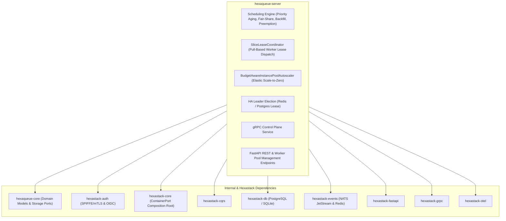

# 🏛️ `hexaqueue-server`

> High-Availability Central Controller and Batch Scheduling Daemon.

[](https://pypi.org/project/hexaqueue-server/)
[](https://www.python.org/downloads/)
[](https://codecov.io/github/TheTrueSCU/hexaqueue)
[](https://dopplereffect.us/hexaqueue/)
[](https://dopplereffect.us/hexastack/)
[](https://dopplereffect.us/hexaqual/)
[](../../LICENSE)

> Part of the [**Hexaqueue Scheduler**](https://dopplereffect.us/hexaqueue/) · Built on [**Hexastack**](https://dopplereffect.us/hexastack/) · Governed by [**Hexaqual**](https://dopplereffect.us/hexaqual/).

---

## 🏗️ Architecture & Dependencies



---

## ⚙️ Configuration & Elastic Cloud Autoscaling

`hexaqueue-server` operates as a standalone daemon or within containerized control planes.

```bash
# Start server with default HTTP (8000) and worker pool (8001) ports
hq server start --host 0.0.0.0 --port 8000
```

### Environment Variables

| Variable | Description | Default |
|---|---|---|
| `HEXAQUEUE_CSP_PROVIDER` | Cloud service provider adapter (`LOCAL`, `OCI`, `GCP`) | `LOCAL` |
| `HEXAQUEUE_WORKER_PORT` | Port dedicated to worker agent lease polling and heartbeats | `8001` |
| `HEXAQUEUE_OCI_INSTANCE_POOL_ID` | OCI Instance Pool OCID for dynamic scale-to-zero compute pools | `None` |
| `HEXAQUEUE_COLLATERAL_BUCKET` | OCI Object Storage bucket name for content-addressed collateral | `hexaqueue-collateral` |
| `HEXAQUEUE_ADMIN_TOKEN` | Bearer token for privileged control plane actions | `None` |
