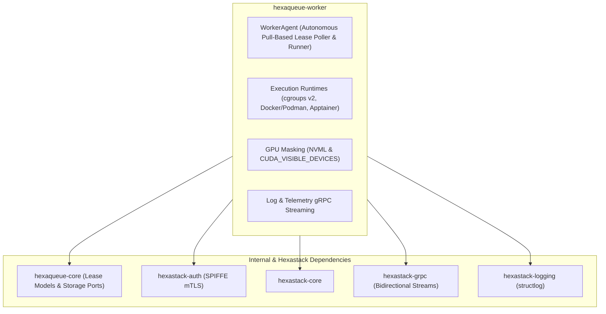

# 🐝 `hexaqueue-worker`

> Lightweight compute node execution daemon with GPU isolation and real-time streaming.

[](https://pypi.org/project/hexaqueue-worker/)
[](https://www.python.org/downloads/)
[](https://codecov.io/github/TheTrueSCU/hexaqueue)
[](https://dopplereffect.us/hexaqueue/)
[](https://dopplereffect.us/hexastack/)
[](https://dopplereffect.us/hexaqual/)
[](../../LICENSE)

> Part of the [**Hexaqueue Scheduler**](https://dopplereffect.us/hexaqueue/) · Built on [**Hexastack**](https://dopplereffect.us/hexastack/) · Governed by [**Hexaqual**](https://dopplereffect.us/hexaqual/).

---

## 🏗️ Architecture & Dependencies



---

## 🏃 Autonomous Pull-Based Worker Agent

In elastic cloud environments (e.g. OCI scale-to-zero instance pools under private subnets), worker nodes run the autonomous `WorkerAgent`:

```bash
# Start autonomous worker agent connecting to controller
hq-worker-agent --controller-url http://10.0.1.101:8001
```

### Agent Lifecycle
1. **Dynamic Registration**: On boot, registers hardware footprint (vCPUs, RAM, architecture) with the controller at `POST /worker/register`.
2. **Lease Polling**: Actively requests work slices via `POST /worker/{id}/lease`.
3. **Collateral Ingestion**: Fetches and unpacks content-addressed workspace bundles (via local cache or signed OCI Object Storage PAR URLs).
4. **Isolated Virtualenv Execution**: Spawns test runners with isolated environments (`VIRTUAL_ENV`, `PATH`).
5. **Outcome Reporting**: Posts exit codes, JUnit reports, and coverage back via `POST /worker/{id}/report`.
6. **Heartbeat & Self-Healing**: Transmits heartbeats every 10 seconds; backs off gracefully when the queue is drained so the cloud pool can scale down.
