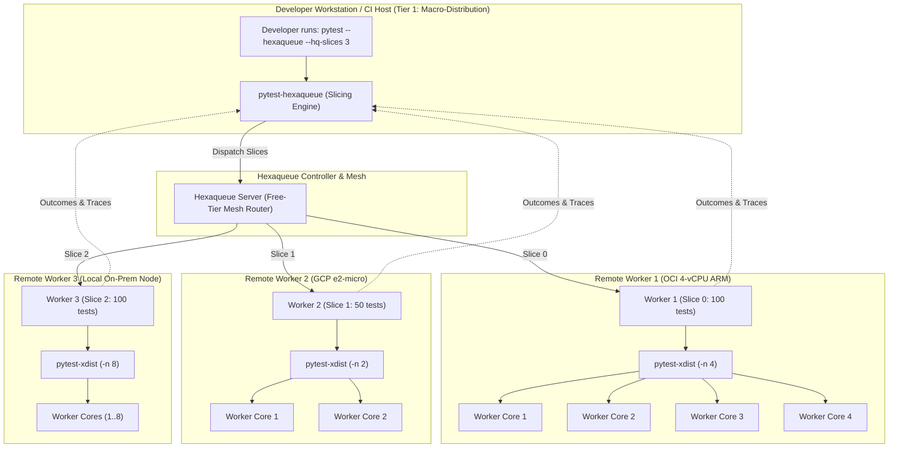

# 🧪 `pytest-hexaqueue`

> Distributed Test Execution, Slicing Engine, and Multi-CSP Free-Tier Bursting Plugin for Pytest.

[](https://pypi.org/project/pytest-hexaqueue/)
[](https://www.python.org/downloads/)
[](https://dopplereffect.us/hexaqueue/)
[](https://dopplereffect.us/hexastack/)
[](https://dopplereffect.us/hexaqual/)
[](../../LICENSE)

---

## 🎯 Overview

`pytest-hexaqueue` is a first-class distributed test execution plugin for `pytest`. It partitions large test suites into balanced execution slices and fans out execution across **Hexaqueue cluster workers** and federated **Multi-CSP Free-Tier Meshes** (OCI, GCP, AWS, Azure, and local nodes), achieving horizontal test scalability with zero cloud spend ($0.00 spend ceiling).

---

## ⚖️ Coexistence & Comparison: `pytest-hexaqueue` vs. `pytest-xdist`

A common question is how `pytest-hexaqueue` relates to the widely used [`pytest-xdist`](https://github.com/pytest-dev/pytest-xdist) plugin. `pytest-hexaqueue` is engineered to work **in place of** `pytest-xdist` for distributed multi-machine execution, or **alongside** `pytest-xdist` in a hybrid two-tier concurrency topology.

### 1. In Place of `pytest-xdist` (Multi-Node & Cloud-Native Execution)

`pytest-xdist` excels at local multi-core parallelism (`pytest -n auto`), spawning worker processes on a single physical host. While `xdist` supports remote execution over SSH (`--tx ssh=...`), setting it up across machines requires identical remote virtualenvs, manual SSH daemon maintenance, fragile socket streams, and offers no queueing, budget governance, or automated repo synchronization.

**`pytest-hexaqueue` replaces `pytest-xdist` when scaling tests beyond a single local machine:**

- **Content-Addressed Workspace Sync (CAS)**: Automatically snapshots uncommitted workspace diffs and git revisions into `hexaqueue-collateral` content-addressed storage (SHA-256), synchronizing code to worker nodes instantly without rsync or shared network mounts.
- **Multi-CSP Free-Tier Mesh**: Schedules test slices across free compute quotas (OCI 4-vCPU ARM, GCP e2-micro, AWS t4g.small, Azure B1s, and local worker pools) while mathematically enforcing a $0.00 spend ceiling.
- **Fair-Share Queueing & Preemption**: Leverages Hexaqueue's central scheduling engine with priority aging and placement constraints rather than naive socket round-robining.
- **Fail-Safe Fallback**: If remote cluster nodes are offline or unreachable, `--hq-fallback` (enabled by default) seamlessly falls back to standard in-process test execution.

```bash
# Replace local xdist with 8 remote multi-CSP cloud slices
pytest --hexaqueue --hq-slices 8 --hq-free-tier
```

---

### 2. Alongside `pytest-xdist` (Two-Tier Hybrid Concurrency)

`pytest-hexaqueue` and `pytest-xdist` operate at different structural layers of the concurrency model and can be combined to achieve maximal compute throughput:

- **Tier 1 (Macro-Level / Horizontal Partitioning)**: `pytest-hexaqueue` partitions the overall test suite into coarse-grained slices and dispatches them across distinct cloud instances and worker nodes.
- **Tier 2 (Micro-Level / Vertical Parallelism)**: Inside each remote worker node (or container), the test runner invokes `pytest -n auto`, distributing that node's assigned slice across all local vCPUs.



---

### 3. Feature Comparison Matrix

| Capability | `pytest-xdist` | `pytest-hexaqueue` | Combined (Hybrid) |
|---|---|---|---|
| **Primary Parallelism Domain** | Single-host multi-process (`-n N`) | Multi-node, multi-cloud cluster (`--hq-slices N`) | Multi-node slices + multi-core execution per node |
| **Compute Topology** | Local machine cores (SSH mode manual/fragile) | Federated multi-CSP mesh (OCI, GCP, AWS, Azure, Local) | Cloud cluster nodes saturated with local worker processes |
| **Workspace & Code Sync** | Requires identical filesystem / mount | Content-addressed SHA-256 CAS delta sync | CAS sync to host, executed across cores |
| **Budget & Cost Safety** | Unaware of cloud costs or quotas | Enforced $0.00 Free-Tier ceiling via Governor | Free compute pooled with local multi-core utilization |
| **Scheduling Intelligence** | Local round-robin / load-balancing | Fair-share, priority aging, compute placement affinity | Cluster scheduling + local worker core distribution |
| **Node Failure Resilience** | Crashed worker fails entire test run | Automatic rescheduling or local fallback | Node failure quarantined away from developer machine |
| **Terminal Reporting** | Aggregates local worker subprocesses | Live streaming telemetry + multi-CSP node annotations | Unified terminal summary with remote node origins |

---

## 🚀 Quickstart & Usage

### 1. Installation

```bash
uv add --dev pytest-hexaqueue
# or
pip install pytest-hexaqueue
```

### 2. Standalone Distributed Run

```bash
# Uses project config in pyproject.toml / hexaqueue.yaml
pytest --hexaqueue

# Activate a named profile (automatically enables Hexaqueue execution)
pytest --profile ci
pytest --profile container
pytest --profile free-tier

# Or using the canonical --hq-profile alias:
pytest --hq-profile ci

# Explicit one-off overrides
pytest --hexaqueue --hq-slices 8
pytest --hexaqueue --hq-config path/to/custom.yaml
```

### 3. Hybrid Two-Tier Execution (Alongside xdist)

In your remote worker execution template or container runner script, configure the runner to consume its assigned slice with `pytest-xdist`:

```bash
# Inside the Hexaqueue worker container executing an assigned slice:
pytest $(cat /tmp/hexaqueue/slice_items.txt) -n auto
```

---

## ⚙️ Configuration & Options Reference

### Configuration via `pyproject.toml` or `hexaqueue.yaml`

Instead of passing CLI flags, configure project defaults and named profiles in `pyproject.toml`:

```toml
[tool.hexaqueue]
server_url = "http://127.0.0.1:8000"
slices = 4
slicer = "round-robin"
fallback = true
mode = "subprocess"

[tool.hexaqueue.profiles.container]
mode = "container"
slices = 4
container = { image = "hexaqueue-worker:latest", runtime = "auto" }

[tool.hexaqueue.profiles.ci]
server_url = "https://hq-cluster.corp.internal"
slices = 16
fallback = false

[tool.hexaqueue.profiles.free-tier]
free_tier = true
slices = 4
pool = "arm64-always-free"

[tool.hexaqueue.profiles.paid-cloud]
free_tier = false
slices = 8
mode = "csp"
```

### CLI Overrides Reference

| Option | Environment Variable | Default | Description |
|---|---|---|---|
| `--hexaqueue` | `HEXAQUEUE_PYTEST` | `False` | Enable Hexaqueue distributed test execution |
| `--hq-config` | `HEXAQUEUE_CONFIG` | None | Path to configuration file (`pyproject.toml` or `hexaqueue.yaml`) |
| `--hq-profile` | `HEXAQUEUE_PROFILE` | None | Active configuration profile name (e.g., `ci`, `container`, `paid-cloud`) |
| `--hq-server` | `HEXAQUEUE_SERVER_URL` | Config / `http://127.0.0.1:8000` | Hexaqueue cluster controller base URL |
| `--hq-token` | `HEXAQUEUE_API_TOKEN` | None | Authentication bearer token |
| `--hq-slices` | `HEXAQUEUE_SLICES` | Config / `4` | Number of parallel execution slices |
| `--hq-container` | `HEXAQUEUE_CONTAINER` | Config / `False` | Execute slices inside isolated OCI container sandboxes |
| `--hq-image` | `HEXAQUEUE_WORKER_IMAGE` | Config / `latest` | Container image tag for worker runtime |
| `--hq-pool` | `HEXAQUEUE_POOL` | Config / `default` | Target compute instance pool for runner placement |
| `--hq-paid` | `HEXAQUEUE_PAID` | Config / `False` | Authorize paid cloud compute (disables zero-cost free-tier guardrails) |
| `--hq-free-tier` | `HEXAQUEUE_FREE_TIER` | Config / `True` | Enforce zero-cost Multi-CSP Free-Tier mesh execution ($0.00 spend ceiling) |
| `--hq-fallback` | `HEXAQUEUE_LOCAL_FALLBACK` | Config / `True` | Fall back to local in-process execution if cluster is unreachable |
| `--hq-slicer` | `HEXAQUEUE_SLICER` | Config / `round-robin` | Test partitioning algorithm: `round-robin` or `file` |
