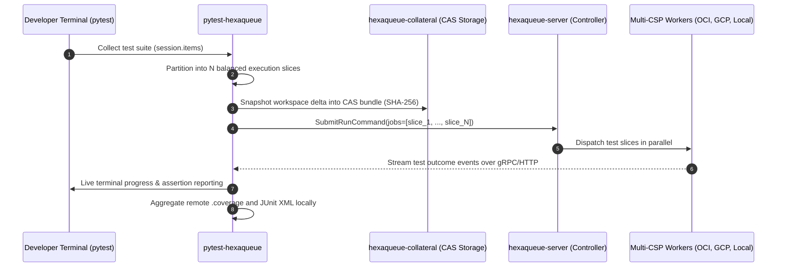

# 🧪 `pytest-hexaqueue`

> Distributed Test Execution, Slicing Engine, and Multi-CSP Free-Tier Bursting Plugin for Pytest.

[](https://pypi.org/project/pytest-hexaqueue/)
[](https://www.python.org/downloads/)
[](https://dopplereffect.us/hexaqueue/)
[](https://dopplereffect.us/hexastack/)
[](https://dopplereffect.us/hexaqual/)
[](../../LICENSE)

---

## 🎯 Overview

`pytest-hexaqueue` is a drop-in distributed execution plugin for pytest that slices test suites and fans out execution across Hexaqueue worker clusters and the federated **Multi-CSP Free-Tier Mesh** (OCI, GCP, AWS, Azure, Local).

### Distributed Slicing Architecture



---

## 🚀 Quickstart & Usage

### 1. Installation

```bash
uv add --dev pytest-hexaqueue
# or
pip install pytest-hexaqueue
```

### 2. Running Distributed Tests

```bash
# Fan out tests across 4 cluster slices
pytest --hexaqueue --hq-slices 4

# Run strictly against the zero-cost Free-Tier mesh
pytest --hexaqueue --hq-slices 5 --hq-free-tier

# Specify explicit controller endpoint
pytest --hexaqueue --hq-server http://hexaqueue.internal:8000 --hq-pool ci-fast
```

---

## ⚙️ CLI Options

| Option | Environment Variable | Default | Description |
|---|---|---|---|
| `--hexaqueue` | `HEXAQUEUE_PYTEST` | `False` | Enable Hexaqueue distributed test execution |
| `--hq-server` | `HEXAQUEUE_SERVER_URL` | `http://127.0.0.1:8000` | Hexaqueue server API endpoint |
| `--hq-slices` | `HEXAQUEUE_SLICES` | `4` | Number of parallel execution slices |
| `--hq-pool` | `HEXAQUEUE_POOL` | `default` | Target compute instance pool |
| `--hq-free-tier` | `HEXAQUEUE_FREE_TIER` | `False` | Enforce zero-cost multi-CSP free-tier bursting |
| `--hq-fallback` | `HEXAQUEUE_LOCAL_FALLBACK` | `True` | Fall back to local execution if cluster is unreachable |
